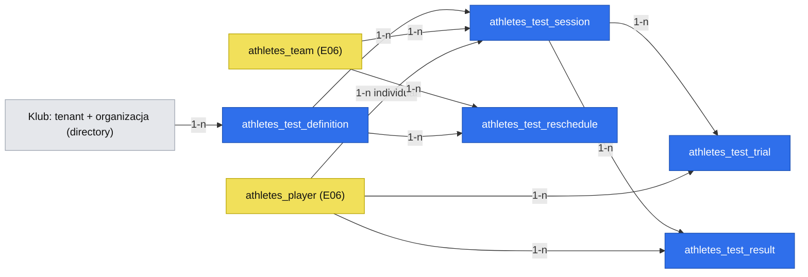

# E02 — Testy i wyniki

**Date**: 2026-10-28
**Status**: Draft — gotowość per faza:
- Faza 1a (katalog z szablonu tylko do odczytu, „Tryb boisko”, widok testu): blokują Q-002 (akceptacja braku offline) i bramka fazy 1 specyfikacji E06.
- Faza 1b (edycja katalogu przez administratora): blokuje dodatkowo Q-006 (konfiguracja zestawu w MVP).
- Faza 2 (poprawki, wyniki dodatkowe, CSV): po bramce fazy 1a.
- Faza 3 (terminy i braki): blokują Q-004 i bramka fazy 2.

Zakres klienta zatwierdzony (Q-001, 2026-10-28).

> Źródła: `.ai/specs/2026-10-22-prd.md` (Stories 3–5, R02, R12, R17, R18, R22, FR-005, NFR-007), epik [#2](https://github.com/mikolajjenczyk/test_athletica/issues/2), historie [#10](https://github.com/mikolajjenczyk/test_athletica/issues/10) (E02-S01), [#11](https://github.com/mikolajjenczyk/test_athletica/issues/11) (E02-S02), [#12](https://github.com/mikolajjenczyk/test_athletica/issues/12) (E02-S03), prototyp `.ai/prototypes/discovery/Atletica-prototyp-lo-fi-rev-053/index.html` (ekrany „Zestaw testów”, „Edytuj zestaw testów”, „Rozpocznij test”, „Tryb boisko”, „Zakończ test”, „Importuj wyniki z CSV”). Zależy od fazy 1 `.ai/specs/2026-10-28-e06-cele-zalecenia-klub.md` (moduł `athletes`, drużyna, zawodnicy, role). Brak `product-brief.md` w repo — ids D/R/N/Q z PRD.

## TLDR

Dziś trener zapisuje wyniki testów na kartce lub w arkuszu i przepisuje je wieczorem; wynik czytany jest bez historii, a retesty wypadają z kalendarza (`[DOCUMENT]`, pitch deck s.3, s.11). Proponujemy (przyszłe zachowanie), w module `athletes`: katalog testów każdego klubu, skopiowany z szablonu Apzumi i edytowany przez administratora (próg „Wyraźna zmiana od” tylko do odczytu); „Tryb boisko” do wpisywania prób drużyny na telefonie, z najlepszą próbą jako wynikiem — **wyłącznie z połączeniem**; poprawki, wyniki nadrobione, testy indywidualne i import przeszłych wyników z CSV, z własnym stanem każdej luki; terminy retestów i brakujące wyniki. Specyfikacja dostarcza definicje i wyniki testów, na które czekają faza 3 E06, karta zawodnika (SPEC 4) i obserwacje AI (SPEC 5).

## Problem Statement

- **Dzień testów dodaje pracę.** Trener mierzy na boisku (telefon 390 px, zimno, rękawiczki — PRD, User Personas) i przepisuje wyniki wieczorem. Klient chce, żeby dzień testów nie dodawał pracy po treningu (deck s.11); PRD liczy to jako guardrail z celem 0 przypadków.
- **Brak historii i uczciwych luk.** Wynik bez poprzednich nie mówi nic; luka pokazana jako zero albo „dobrze” fałszuje średnie (R12).
- **Retesty wypadają.** Cele pilotażu: > 80% testów i > 70% retestów wykonanych (deck s.30); bez terminów i listy braków nikt tego nie pilnuje.
- **Dowody.** `[DOCUMENT]` — pitch deck, notatki i relacja założyciela; żaden trener poza założycielem nie opisał dnia testów (A01, Q04). Panel syntetyczny 2026-10-28: trenerzy małych akademii mają wyniki na kartce lub w telefonie ze stopera (hipoteza `[SYNTHETIC]` 9) — pytanie, nie wymaganie.

## Overview and Success Measures

- **Primary outcome:** w pilotażu > 80% zaplanowanych testów i > 70% retestów ma wyniki w aplikacji (deck s.30).
- **Leading indicators:** odsetek sesji „Tryb boisko” zakończonych tego samego dnia; odsetek wyników wpisanych na boisku vs nadrobionych/z CSV (z pól `is_makeup` i klucza importu); liczba blokad z powodu braku połączenia (sygnał, czy decyzja o braku offline się broni). Odczyt ręczny z bazy i `audit_logs` w pilotażu; zdarzenia analityczne zależą od Q29 i nie są w tej specyfikacji.
- **Baseline:** brak (A01 — czasu nie mierzono).
- **Market / product reference:** systemy AMS (Smartabase, Kitman Labs, Teamworks — wiedza ogólna, bez weryfikacji źródeł). Przyjmujemy: wpis per zawodnik z dużymi polami, najlepsza próba, katalog testów z jednostką i kierunkiem. Odrzucamy: tryb offline (decyzja Q2), wiele metod na test (po MVP, D260), konfigurowalne formuły wyniku.

## Goals

- **REQ-001** — Każdy klub ma katalog do 12 definicji testów skopiowany z szablonu Apzumi; administrator klubu edytuje nazwę, wariant, jednostkę, kierunek, liczbę prób, „Powtarzaj co”, kolejność i to, które (najwyżej sześć) są aktywne; próg „Wyraźna zmiana od” i jego źródło są tylko do odczytu (R17, D99, D213, D260, FR-005).
- **REQ-002** — „Rozpocznij test” pyta tylko o drużynę albo jednego zawodnika i datę; wcześniejsze daty dozwolone, przyszłe i sprzed dołączenia zawodnika nie (D307, D162).
- **REQ-003** — „Tryb boisko”: duża klawiatura, powody jako duże przyciski, zawodnicy w dowolnej kolejności, „Dalej” do następnego z brakami, cele dotyku 48 px (D310, D331, NFR-007).
- **REQ-004** — Wynikiem jest najlepsza ważna próba z jednostką; próba odbiegająca o > 10% od ostatniego wyniku lub innych prób ma znak „sprawdź”, bez blokady (R02, D372).
- **REQ-005** — Bez połączenia „Tryb boisko” blokuje wpisywanie i mówi, co zostało zapisane; nic nie jest zapisane podwójnie (zastępuje D349/NFR-005 — Q-002).
- **REQ-006** — „Zakończ test” pokazuje podsumowanie (wyniki, „Nie wykonał”, puste pola) i następny krok (D202); niezakończony test jest widoczny na stronie „Zestaw testów” jako „Test w trakcie · Wróć do testu” (wersja na Pulpicie należy do SPEC 7).
- **REQ-013** — Widok testu pokazuje wyniki drużyny i zawodników z datą, jednostką, stanem luki i „Brak wcześniejszego pomiaru”; serwis odczytu wyników (`athletesTestResultsService`) jest kontraktem dla SPEC 4–7.
- **REQ-007** — „Edytuj wyniki” poprawia wynik w miejscu z oznaczeniem „poprawiony <data>” (D61) i emituje zdarzenie, na które reagują zatwierdzone raporty (R18, SPEC 6).
- **REQ-008** — „Dodaj wynik”: „nadrobiony wynik” (do istniejącej sesji) albo „Test indywidualny” (nigdy nie liczy się do średnich drużyny) (D342, D113).
- **REQ-009** — Import CSV przeszłych wyników z podglądem i odrzuceniami jak w R22 (D177).
- **REQ-010** — Każda luka ma własny stan: puste, „Próba nieważna”, „Nie wykonał” z powodem, „Dołączył później”; „Brak wcześniejszego pomiaru” wyliczane przy odczycie — nigdy zero (R12).
- **REQ-011** — Termin = data testu + „Powtarzaj co”; minięty: „termin był <data>” bursztynowo z tekstem, nigdy czerwono (D71, D169).
- **REQ-012** — „Zrealizowane: N z 6 · od <data>”, „Następne testy”, „Brakujące wyniki”, „Zmień termin” ze starą i nową datą obok siebie (D251, D340, D257).

## Non-goals

- Tryb offline i kolejka wyników bez zasięgu (Q2 → brak; zastępuje D349, NFR-005).
- Wiele metod na test, konfigurowalne formuły wyniku, wartość gotowości, integracje z urządzeniami (po MVP, PRD Phase 2).
- „Test gotowości (CMJ)” poza zestawem (P2, czeka na klienta, Q80).
- Średnie drużyny, wykresy i porównania — liczy je karta zawodnika i strona drużyny (SPEC 4); tu tylko flaga, czy wynik liczy się do średniej.
- Eksport wyników (FR-007, „wkrótce”).
- Rekordy i progi oceny wyniku (Q54, Q64).

## Proposed Solution

W module `athletes`: definicje testów per klub (kopia szablonu z pliku modułu), sesje testów, próby i wyniki zapisywane komendami z undo, wyliczane terminy z nadpisaniami. „Tryb boisko” to strona mobilna, która zapisuje próby jednego zawodnika jedną komendą przy „Dalej”; bez połączenia blokuje się. Import CSV używa tego samego komponentu podglądu co import arkuszy w SPEC 3 i tej samej komendy zapisu wyniku. Terminy i liczniki są wyliczane przy odczycie z wyników i „Powtarzaj co”; przechowujemy tylko zmiany terminu.

### Design Decisions and Alternatives

| Decision | Rationale | Alternative considered | Why rejected / deferred |
|---|---|---|---|
| Brak offline; blokada wpisywania bez połączenia (Q2) | Decyzja właściciela; prostsza i bez ryzyka podwójnego zapisu z kolejki | Kolejka IndexedDB; PWA | Odrzucone przez użytkownika 2026-10-28; zastępuje D349/NFR-005 — wymaga akceptacji Toma (Q-002) |
| Katalog per klub z szablonu, próg tylko do odczytu (Q3) | Kluby różnią się testami; D99 utrzymane | Wspólny katalog; pełna edycja | Wspólny odrzucony przez użytkownika; pełna edycja łamie D99 |
| Szablon kopiowany przez subskrybenta `directory.organization.created` + `seedDefaults` | Nowe i istniejące kluby dostają katalog idempotentnie | Ręczna akcja operatora | Ryzyko pustego katalogu |
| Zapis prób zawodnika jedną komendą z kluczem idempotencji | „Dalej” = jeden atomowy zapis; ponowienie nie dubluje | Zapis każdej próby osobno | Więcej żądań, częściowe stany |
| Terminy wyliczane, przechowywane tylko zmiany | Brak rozjazdu przy poprawkach dat | Tabela terminów aktualizowana zdarzeniami | Ryzyko niespójności |
| Dopasowanie CSV po imieniu i nazwisku w drużynie (Q4) | Plik trenera nie zna naszych id | Id z szablonu eksportu | Wymusza nasz szablon |
| „sprawdź” wyliczane przy odczycie | Zawsze aktualne po poprawkach | Flaga zapisana | Nieaktualna po korekcie |

## Domain Vocabulary and Business Rules

| Term / invariant | Precise meaning or rule | Source of truth | Failure behavior |
|---|---|---|---|
| Definicja testu | Test klubu: polska nazwa (pierwsza), wariant, jednostka, kierunek (`higher_better`/`lower_better`), liczba prób (1–5), liczona próba (`best`), „Wyraźna zmiana od” + źródło (tylko odczyt), „Powtarzaj co” (tygodnie), kolejność, aktywna | `athletes_test_definition` | Siódma aktywna → 409; trzynasta definicja → 409 (R17) |
| Szablon testów | Plik modułu z 12 definicjami Apzumi i progami (D99); treść czeka na Q60 | `src/modules/athletes/lib/testTemplate.ts` | Kopiowany tylko do nowych klubów i brakujących definicji; nigdy nie nadpisuje edycji klubu |
| Sesja testu | Jeden test, jedna data, drużyna albo jeden zawodnik; `kind` `team`/`individual`; stan `open`/`finished` | `athletes_test_session` | Druga otwarta sesja tego testu dla drużyny → przejście do istniejącej |
| Próba | Wartość jednej próby zawodnika albo „Próba nieważna” | `athletes_test_trial` | Wartość ujemna / poza zakresem jednostki → 400 |
| Wynik | Najlepsza ważna próba (R02) albo stan luki; jeden na (sesja, zawodnik) | `athletes_test_result` | Drugi → aktualizacja tego samego (idempotencja) |
| Stany luk | `empty`, `invalid_attempt` (wszystkie próby nieważne), `not_performed` + powód, `joined_later`; „Brak wcześniejszego pomiaru” wyliczane | `athletes_test_result.state` | Nigdy wartość 0 zamiast stanu |
| Powód „Nie wykonał” | Kod z listy (Q-003) + opcjonalna notatka (szyfrowana); widzi tylko trener (D109) | `athletes_test_result` | Odpowiedź bez `athletes.tests.record` pomija powód |
| „sprawdź” | Najlepsza próba różni się o > 10% od ostatniego wyniku zawodnika w tym teście albo od innej ważnej próby (D372) | wyliczane | tylko znacznik |
| Wynik nadrobiony | Wynik dopisany do istniejącej sesji po jej dacie; `is_makeup = true` | wynik | Data nadrobienia ≥ data sesji |
| Test indywidualny | Sesja `kind = individual`; `counts_in_team_average = false` (D113) | sesja + wynik | — |
| Korekta | Edycja wyniku/próby po zapisie: `corrected_at`, „poprawiony <data>”; emituje `athletes.test_result.corrected` (R18) | wynik | Konflikt wersji → 409 |
| Termin | `ostatnia data testu drużyny + powtarzaj_co`; zmiana terminu zapisuje starą i nową datę (D257) | wyliczane + `athletes_test_reschedule` | — |
| „Zrealizowane: N z 6 · od <data>” | definicja — Q-004 | wyliczane | — |

## Users, Permissions, and Scope

| Actor | Allowed outcomes | Scope rule | Required feature IDs |
|---|---|---|---|
| Administrator klubu | Edycja katalogu testów i „Powtarzaj co” | własny klub (tenant klubu i jego organizacja) | `athletes.tests.catalog.manage`, `athletes.tests.view` |
| Trener | Rozpoczęcie i zakończenie testu, wpis prób, poprawki, wyniki dodatkowe, import CSV, zmiana terminu; widzi powody | własny klub | `athletes.tests.view`, `athletes.tests.record` |
| Dyrektor | Podgląd definicji, wyników i terminów bez powodów i notatek | własny klub | `athletes.tests.view` |

Klub to osobny tenant z jedną organizacją `directory` (E06, Q4 po weryfikacji `auth`). `tenantId` i `organizationId` pochodzą z kontekstu uwierzytelnionego żądania, jak w E06; wszystkie referencje (`team_id`, `player_id`, `test_definition_id`, `session_id`) walidowane w tym samym tenancie i organizacji; brak organizacji → 403.

## Reuse and Ownership Map

| Capability | Reuse / extend / app-own | Existing module or new module | Integration seam | Why |
|---|---|---|---|---|
| Drużyna, zawodnik, role | reuse | `athletes` (E06 faza 1) | id w module | Ten sam moduł |
| Katalog, sesje, próby, wyniki, terminy | app-own | `athletes` | encje modułu | Domena aplikacji |
| Utworzenie klubu | reuse | `directory` | subskrybent `directory.organization.created` | Kopia szablonu |
| Podgląd importu | app-own, **właściciel: ta specyfikacja (faza 2)** | `athletes` | komponent podglądu; SPEC 3 (import arkuszy) go używa i zależy od fazy 2 | Jedno zachowanie R22, jeden właściciel |
| Dziennik zmian | reuse | `audit_logs` | komendy z undo | — |

## Architecture and Data Flow

```text
Administrator -> /backend/athletes/tests (Zestaw testów) -> athletes.test_definition.update
directory.organization.created -> subskrybent -> kopia szablonu -> athletes_test_definition (idempotentnie)
Trener -> /backend/athletes/tests/start -> athletes.test_session.start -> /backend/athletes/tests/field/[sessionId]
       -> „Dalej” -> athletes.test_result.record (próby + wynik, klucz idempotencji) -> athletes.test_result.recorded
       -> „Zakończ test” -> athletes.test_session.finish -> athletes.test_session.finished
Trener -> „Edytuj wyniki” -> athletes.test_result.correct -> athletes.test_result.corrected (SPEC 6: raport wymaga ponownego zatwierdzenia)
Trener -> „Importuj wyniki z CSV” -> POST preview (bez zapisu) -> POST import -> athletes.test_result.record × N
Odczyty: terminy, liczniki, „sprawdź”, „Brak wcześniejszego pomiaru” — wyliczane w serwisie modułu
```

- **Module boundaries:** wszystko w `athletes`; wyniki, definicje i zawodnicy muszą być spójni transakcyjnie.
- **Extension points:** zdarzenia `athletes.test_*` dla SPEC 4–7 (karta, AI, raporty, Pulpit); serwis odczytu wyników w DI modułu (`athletesTestResultsService`) zamiast zapytań z innych specyfikacji.
- **Alternatives considered:** jedna tabela „wynik z próbami w JSON” — odrzucona, bo próby są potrzebne do „sprawdź” i korekt.
- **Compatibility:** tylko nowe encje, trasy, zdarzenia i funkcje.

## User Journeys

### Journey J-001 — Zestaw testów klubu

1. Klub powstaje; subskrybent kopiuje szablon 12 definicji.
2. Administrator otwiera „Zestaw testów”, wybiera sześć aktywnych, zmienia „Powtarzaj co” i kolejność.
3. Próg „Wyraźna zmiana od” jest widoczny z dopiskiem źródła, bez edycji.
4. Błąd: siódma aktywna → komunikat z liczbą aktywnych; konflikt edycji → 409 z ponownym wczytaniem.

### Journey J-002 — Dzień testów na boisku

1. Trener klika „Rozpocznij test” przy aktywnym teście, wybiera drużynę (albo zawodnika) i datę.
2. „Tryb boisko” pokazuje zawodnika, pola prób i przyciski powodów; trener wpisuje próby i klika „Dalej” — wynik zapisany, ekran przechodzi do następnego z brakami.
3. „Zakończ test” pokazuje podsumowanie i następny krok; sesja `finished`.
4. Błąd: utrata połączenia — wpisywanie zablokowane, baner „Brak połączenia — zapisano N z M zawodników; niezapisane próby zawodnika X trzeba wpisać ponownie”; po powrocie połączenia blokada znika; ponowne „Dalej” z tym samym kluczem nie dubluje wyniku.

### Journey J-003 — Poprawki, nadrobienia, CSV

1. Trener w widoku testu klika „Edytuj wyniki”, poprawia próbę — wynik ma „poprawiony <data>”.
2. „Dodaj wynik” → „nadrobiony wynik” (wybór sesji i zawodnika) albo „Test indywidualny”.
3. „Importuj wyniki z CSV”: test, data, plik → podgląd (odczytane, odrzucone z numerem i powodem) → „Zapisz”.
4. Błąd: niejednoznaczny zawodnik → wiersz odrzucony; plik w złym formacie → powód, nic nie zapisane.

### Journey J-004 — Terminy

1. Trener otwiera „Terminy”: „Zrealizowane: N z 6 · od <data>”, „Następne testy”, „Brakujące wyniki”.
2. Minięty termin: „termin był <data>” bursztynowo.
3. „Zmień termin” pokazuje starą i nową datę obok siebie.

## UI and Interaction Contracts

Referencje: `.ai/guides/backend-ui.md`, wzorce `example` (`ui.page-shell`, `ui.datatable`, `ui.form-create`, `ui.form-edit`), prototyp rev-053. Teksty w `src/modules/athletes/i18n/pl.json` (+ `en.json`); nazwy testów z katalogu, polska pierwsza (FR-005, D380, D392).

| Surface / route | Purpose and primary actions | Data source / mutations | Closest installed reference | Canonical shell / components | Required states | Requirement IDs |
|---|---|---|---|---|---|---|
| `/backend/athletes/tests` | „Zestaw testów”: lista definicji, aktywne, „Rozpocznij test”; administrator: „Edytuj zestaw testów” | `/api/athletes/test-definitions` | `example/components/TodosTable.tsx` | `Page`, `DataTable`, `CrudForm` (edycja) | loading, empty, error, conflict, permission denied | REQ-001 |
| `/backend/athletes/tests/start` | „Rozpocznij test”: drużyna/zawodnik, data | `POST /api/athletes/test-sessions` | `example/backend/todos/create/page.tsx` | `CrudForm` | walidacja dat | REQ-002 |
| `/backend/athletes/tests/field/[sessionId]` | „Tryb boisko” | `POST /api/athletes/test-results/record`, `POST /api/athletes/test-sessions/finish` | brak bezpośredniego — wyjątek uzasadniony niżej | `Page`, wspólne kontrolki przycisków i pól, region live | loading, offline-blocked, error, conflict, done | REQ-003…REQ-006 |
| `/backend/athletes/tests/[definitionId]` | Widok testu: sesje, wyniki, stany luk, „Brak wcześniejszego pomiaru” (faza 1, tylko odczyt); „Edytuj wyniki”, „Dodaj wynik”, „Importuj wyniki z CSV” (faza 2) | `/api/athletes/test-results`, `/api/athletes/test-imports/*` | `example/components/TodosTable.tsx` | `DataTable`, `CrudForm`, dialog podglądu | j.w. + stany luk | REQ-007…REQ-010, REQ-013 |
| `/backend/athletes/tests/due` | „Terminy”: liczniki, następne, brakujące, „Zmień termin” | `GET /api/athletes/test-due`, `POST /api/athletes/test-reschedules` | `example/components/TodosTable.tsx` | `DataTable`, dialog `CrudForm` | j.w. | REQ-011, REQ-012 |

**Wyjątek „Tryb boisko”:** to nie formularz CRUD, tylko ekran wprowadzania jednym kciukiem w złych warunkach (D310); używa przycisków, pól i tokenów systemu projektowego, bez surowych formularzy i `fetch` (zapis przez wspólne helpery API), ale z własnym układem dużej klawiatury. Uzasadnienie: `CrudForm` nie wspiera klawiatury numerycznej 48 px z nawigacją „Dalej”.

### `/backend/athletes/tests/field/[sessionId]` — Tryb boisko

```text
┌──────────────────────────────────────┐
│ CMJ · 28.10 · zapisano 12 z 24       │
│ ⚠ Brak połączenia — wpisywanie        │
│   zablokowane (tylko gdy offline)    │
├──────────────────────────────────────┤
│ {Zawodnik}                ‹ lista ›  │
│ Próba 1 [ 41.5 ] Próba 2 [ 43.0 ] …  │
│ [Nie wykonał] [Próba nieważna]       │
│ ┌───┬───┬───┐                        │
│ │ 7 │ 8 │ 9 │  duża klawiatura 48 px │
│ └───┴───┴───┘                        │
│ [Dalej →]           [Zakończ test]   │
└──────────────────────────────────────┘
```

- **Behavior:** „Dalej” zapisuje próby zawodnika (klucz idempotencji z klienta) i przechodzi do następnego z brakami; „sprawdź” pokazany przy próbie bez blokady; powody jako duże przyciski; wybór zawodnika z listy w dowolnej kolejności. Utrata połączenia (zdarzenie przeglądarki lub błąd sieci zapisu) → klawiatura i przyciski wyłączone, baner z liczbą zapisanych i nazwą niezapisanego zawodnika; powrót połączenia → odblokowanie; niezapisane próby nie są przechowywane.
- **Responsive and accessibility:** 360–430 px pionowo; cele 48 px; komunikaty zapisu i blokady przez region live; kontrast w słońcu (NFR-006).
- **Localization:** `athletes.field.*`.
- **Design-system and theming:** tokeny semantyczne, ciemny motyw, brak twardych kolorów.

### UI architecture

| Role | Navigation groups in order | Dashboard / injected widgets | Login-to-primary-task flow |
|---|---|---|---|
| Trener | Drużyna → Testy, Terminy | „Test w trakcie · Wróć do testu” na stronie „Zestaw testów” (Pulpit: SPEC 7) | logowanie → Testy → „Rozpocznij test” → „Tryb boisko” (≤ 3 kliknięcia) |
| Administrator klubu | Klub → Zestaw testów | brak | logowanie → Zestaw testów → „Edytuj” |
| Dyrektor | Drużyna → Testy (podgląd) | brak | podgląd |

| Surface / widget | Empty state guidance and action | Responsive behavior | Keyboard / focus behavior |
|---|---|---|---|
| Zestaw testów | „Brak aktywnych testów — wybierz do sześciu” | lista na telefonie | fokus na liście |
| Widok testu | „Ten test jeszcze się nie odbył” + „Rozpocznij test” | tabela → lista na telefonie | Enter zapisuje w edycji, Esc anuluje |
| Terminy | „Brak terminów — rozpocznij pierwszy test” | lista | — |

## Data Models

Wszystkie encje w `src/modules/athletes/data/entities.ts`, standardowe pola zakresu, `updated_at` (blokada optymistyczna), `deleted_at`. Bez relacji ORM poza modułem.

### `athletes_test_definition`

| Field | Type / nullability | Scope / index | Sensitive / encrypted | Lifecycle and validation |
|---|---|---|---|---|
| `template_key` | text, required | unikalne (org, template_key) | no | stały klucz z szablonu |
| `name`, `variant` | text, required / nullable | unikalne (org, name, variant) | no | polska nazwa pierwsza (FR-005) |
| `unit`, `direction` | text, enum | — | no | `higher_better`/`lower_better` |
| `attempts` | int, required | — | no | 1–5 |
| `counting_rule` | enum `best`, required | — | no | R02; rozszerzalne po MVP |
| `clear_change_threshold`, `threshold_source` | decimal null, text null | — | no | **tylko odczyt** w API (D99); aktualizuje tylko synchronizacja szablonu |
| `repeat_every_weeks` | int, required | — | no | 1–26, domyślnie 6 (Q5, D71) |
| `sort_order`, `is_active` | int, bool | — | no | ≤ 6 aktywnych, ≤ 12 definicji na klub (R17) |

### `athletes_test_session`

| Field | Type / nullability | Scope / index | Sensitive / encrypted | Lifecycle and validation |
|---|---|---|---|---|
| `test_definition_id` | UUID, required | indeks (org, definition, tested_on) | no | aktywna przy starcie |
| `kind` | enum `team`/`individual` | — | no | — |
| `team_id` / `player_id` | UUID | — | no | `team` → team_id; `individual` → player_id |
| `tested_on` | date, required | — | no | nie w przyszłości (D162) |
| `status`, `finished_at` | enum `open`/`finished`, timestamp | częściowy unikalny: jedna `open` na (org, team, definition) | no | — |
| `started_by_user_id` | UUID | — | no | z kontekstu |

### `athletes_test_trial`

| Field | Type / nullability | Scope / index | Sensitive / encrypted | Lifecycle and validation |
|---|---|---|---|---|
| `session_id`, `player_id`, `attempt_no` | UUID, UUID, int | unikalne (session, player, attempt_no) | no | 1…attempts |
| `value`, `is_invalid` | decimal null, bool | — | no | `value` null gdy `is_invalid` |

### `athletes_test_result`

| Field | Type / nullability | Scope / index | Sensitive / encrypted | Lifecycle and validation |
|---|---|---|---|---|
| `session_id`, `player_id`, `test_definition_id`, `tested_on` | UUID ×3, date | unikalne (session, player); indeks (org, player, definition, tested_on) | no | `tested_on ≥ player.joined_at` (D162) |
| `value` | decimal, nullable | — | no | najlepsza ważna próba; null dla luk |
| `state` | enum `recorded`/`empty`/`invalid_attempt`/`not_performed`/`joined_later` | — | no | nigdy 0 zamiast stanu (R12) |
| `reason_code`, `reason_note` | text null, text null | — | `reason_note` **tak** | tylko dla `not_performed`; widoczne tylko z `athletes.tests.record` (D109) |
| `is_makeup`, `counts_in_team_average` | bool, bool | — | no | individual → false (D113) |
| `corrected_at` | timestamp null | — | no | „poprawiony <data>” (D61) |
| `idempotency_key` | text, required | unikalne (org, idempotency_key) | no | z klienta lub z importu |

### `athletes_test_reschedule`

| Field | Type / nullability | Scope / index | Sensitive / encrypted | Lifecycle and validation |
|---|---|---|---|---|
| `team_id`, `test_definition_id`, `cycle_base_on` | UUID, UUID, date | unikalne (org, team, definition, cycle_base_on) | no | podstawa cyklu = data ostatniego testu |
| `original_due_on`, `new_due_on`, `changed_by_user_id` | date, date, UUID | — | no | obie daty pokazywane (D257) |



Encje E06 oznaczone jako planowane (specyfikacja E06, faza 1). Widok HTML w `.ai/data-model/` pominięty — Mermaid jest wiążący. Migracje przez `yarn db:generate` po każdej fazie, przegląd, zastosowanie po zgodzie.

## API, Command, and Error Contracts

Trasy przez `makeCrudRoute` (per-metodowa `metadata`, eksport `openApi`), zapisy przez komendy z undo; edycje wysyłają `updatedAt`, konflikt → 409.

| Method / command | Path / ID | Auth and feature gate | Input | Success response / event | Errors and concurrency | Requirement IDs |
|---|---|---|---|---|---|---|
| `GET/PUT` | `/api/athletes/test-definitions` | `.tests.view` / `.tests.catalog.manage` | edytowalne pola; `clearChangeThreshold`, `thresholdSource` odrzucane w PUT | `athletes.test_definition.updated` | 400 (próba zmiany progu), 409 (7. aktywna, wersja) | REQ-001 |
| `GET` | `/api/athletes/options/tests` | `.tests.view` | `q`, `activeOnly` | `{ items: [{ id, label }] }` | 403 | REQ-001 |
| `POST` | `/api/athletes/test-sessions` | `.tests.record` | `{ testDefinitionId, kind, teamId?, playerId?, testedOn }` | 201 / istniejąca otwarta; `athletes.test_session.started` | 400 (daty), 409 | REQ-002 |
| `POST` | `/api/athletes/test-sessions/finish` | `.tests.record` | `{ id, updatedAt }` | podsumowanie; `athletes.test_session.finished` | 409 | REQ-006 |
| `POST` | `/api/athletes/test-results/record` | `.tests.record` | `{ sessionId, playerId, trials: [{ attemptNo, value?, isInvalid }], state?, reasonCode?, reasonNote?, idempotencyKey, isMakeup? }` | wynik z `checkFlag`; `athletes.test_result.recorded` | 400, 409; ten sam klucz → ta sama odpowiedź | REQ-003…REQ-005, REQ-008, REQ-010 |
| `PUT` | `/api/athletes/test-results` | `.tests.record` | korekta prób/stanu + `updatedAt` | `athletes.test_result.corrected` | 409 | REQ-007 |
| `GET` | `/api/athletes/test-results` | `.tests.view` | `definitionId`, `teamId`, `playerId`, zakres dat | wyniki; bez `reasonCode/Note` dla samego `.view` | 403 | REQ-010 |
| `POST` | `/api/athletes/test-imports/preview` | `.tests.record` | multipart: plik, `testDefinitionId`, `testedOn`, `teamId` | `{ rows, rejected: [{ line, reason }] }` — bez zapisu | 400 (format) | REQ-009 |
| `POST` | `/api/athletes/test-imports/commit` | `.tests.record` | ten sam plik + parametry | `{ saved, rejected }`; `idempotencyKey = hash(plik, wiersz)` | 400, 409 | REQ-009 |
| `GET` | `/api/athletes/test-due` | `.tests.view` | `teamId` | `{ done, of, since, next[], missing[] }` | 403 | REQ-011, REQ-012 |
| `POST` | `/api/athletes/test-reschedules` | `.tests.record` | `{ teamId, testDefinitionId, newDueOn }` | `athletes.test_due.rescheduled` | 400, 409 | REQ-012 |

CSV: kolumny `imię`, `nazwisko`, `próba 1` … `próba N` (N = `attempts`), opcjonalnie `powód`; UTF-8, separator `;` lub `,`; test i data wybierane w UI. Dopasowanie zawodnika: imię + nazwisko bez wielkości liter i polskich znaków, w drużynie, w pamięci po odszyfrowaniu (≤ 35 osób); 0 lub > 1 trafienie → wiersz odrzucony.

## Events, Jobs, Notifications, and Cross-Module Flows

| Trigger | Producer | Consumer | Side effect | Retry / idempotency / audit behavior |
|---|---|---|---|---|
| `directory.organization.created` | `directory` | `athletes` subskrybent | kopia szablonu testów | idempotentny po `(org, template_key)`; `seedDefaults` uzupełnia istniejące kluby |
| `athletes.test_session.started|finished` | `athletes` | SPEC 7 (Pulpit „Test w trakcie”) | — | po commicie |
| `athletes.test_result.recorded|corrected` | `athletes` | SPEC 6 (raport wymaga ponownego zatwierdzenia, R18), SPEC 5 | — | po commicie; ładunek bez powodów i notatek |
| `athletes.test_definition.updated`, `athletes.test_due.rescheduled` | `athletes` | `audit_logs` | — | po commicie |

Brak zadań w tle.

## Security, Privacy, and Compliance

- **Authorization:** funkcje `athletes.tests.*`; dyrektor bez powodów i notatek (D109).
- **Tenant isolation:** klub = tenant; każdy odczyt i zapis filtruje `tenant_id` + `organization_id` z kontekstu; referencje w zakresie; import dopasowuje tylko w drużynie klubu; brak organizacji → 403.
- **Sensitive data:** `reason_note` w mapie szyfrowania; kody powodów nie zawierają diagnoz (N17) — lista do akceptacji (Q-003); zawodnicy odszyfrowywani w pamięci tylko na czas dopasowania CSV; pliki CSV nie są przechowywane.
- **Abuse and failure modes:** ponowienie z tym samym kluczem nie dubluje; limit rozmiaru pliku (1 MB) i wierszy (500); błędy importu podają numer wiersza bez treści danych osobowych w logach.

## Integration Coverage

| Test ID | Level | Setup / fixture | Actions | Assertions | Requirement IDs |
|---|---|---|---|---|---|
| TEST-001 | integration | nowy klub (tenant + organizacja) | utworzenie klubu przez operatora; drugi przebieg `seedDefaults` | 12 definicji, brak duplikatów | REQ-001 |
| TEST-002 | integration | administrator | edycja definicji, 7. aktywna, próba zmiany progu | 409; 400; próg bez zmian | REQ-001 |
| TEST-003 | integration | trener, drużyna | start z datą przyszłą i sprzed dołączenia; poprawny start | 400; sesja `open` | REQ-002 |
| TEST-004 | integration | sesja | zapis prób, ponowienie z tym samym kluczem, „sprawdź” | jeden wynik = najlepsza próba; flaga przy > 10% | REQ-004, REQ-005 |
| TEST-005 | UI | „Tryb boisko” | symulacja offline w przeglądarce | klawiatura wyłączona, baner z liczbą zapisanych; po powrocie odblokowanie | REQ-003, REQ-005 |
| TEST-006 | integration | sesja z lukami | „Zakończ test” | podsumowanie z „Nie wykonał” i pustymi | REQ-006, REQ-010 |
| TEST-007 | integration | wynik | korekta, stara wersja | „poprawiony <data>”, zdarzenie `corrected`; 409 | REQ-007 |
| TEST-008 | integration | sesja | nadrobiony; indywidualny | `is_makeup`; `counts_in_team_average=false` | REQ-008 |
| TEST-009 | integration | drużyna z dwoma „Jan Kowalski” | podgląd i import CSV | odrzucony wiersz niejednoznaczny, zły format → nic nie zapisane; ponowny import nie dubluje | REQ-009 |
| TEST-010 | security | kluby A i B; dyrektor | odczyty i zapisy B; dyrektor czyta wyniki | 403/404; brak powodów w odpowiedzi | REQ-010 |
| TEST-011 | integration | wyniki z datami | terminy, minięty termin, zmiana terminu | daty wyliczone; obie daty przy zmianie | REQ-011, REQ-012 |
| TEST-012 | UI | strony | loading/empty/error/conflict, klawiatura, 360 px, jasny/ciemny | obserwowalne stany | wszystkie |
| TEST-013 | integration | wyniki zawodnika w dwóch klubach | wywołanie `athletesTestResultsService` dla zawodnika i drużyny; otwarta sesja | historia w zakresie klubu z „Brak wcześniejszego pomiaru” dla pierwszego wyniku; „Test w trakcie” na stronie zestawu | REQ-006, REQ-013 |

Ścieżki: `.ai/qa/tests/athletes/tests-*.spec.ts`.

## Implementation Phases

### Phase 1 — Katalog testów i „Tryb boisko” (E02-S01 #10)

- **Depends on:** faza 1 E06 (moduł, drużyna, zawodnicy, role); Q-002; część 1b dodatkowo Q-006
- **Outcome:** klub ma katalog testów; trener prowadzi test na boisku z połączeniem, kończy go podsumowaniem i widzi wyniki w widoku testu.
- **Why this order / value delivered:** daje definicje, wyniki i serwis odczytu dla fazy 3 E06, SPEC 4 i SPEC 5; zdejmuje przepisywanie wyników.
- **Deliverables:**
  - **1a** — szablon testów, subskrybent i `seedDefaults`; `athletes_test_definition` (katalog tylko do odczytu, aktywne = pierwsze sześć z szablonu), `_session`, `_trial`, `_result`; komendy; trasy definicji (GET), sesji, zapisu i odczytu wyników, opcji testów; `athletesTestResultsService` w DI; strony „Zestaw testów” (z „Test w trakcie · Wróć do testu”), „Rozpocznij test”, „Tryb boisko”, „Zakończ test”, widok testu tylko do odczytu.
  - **1b** — edycja katalogu przez administratora („Edytuj zestaw testów”, PUT definicji, limit sześciu aktywnych).
- **Independent slices / estimated commits:** (a) katalog + szablon, (b) sesje, zapis i serwis odczytu, (c) „Tryb boisko” i widok testu — (c) po (b); 1b osobno; ~7 commitów.
- **Requirements closed:** REQ-001 (1a: odczyt; 1b: edycja), REQ-002…REQ-006, REQ-010 (stany luk przy wpisie), REQ-013
- **Tests:** TEST-001, TEST-003…TEST-006, TEST-010, TEST-012, TEST-013 (1a); TEST-002 (1b)
- **Validation:** `yarn generate`, `yarn db:generate` (przegląd), `yarn typecheck`, `yarn lint`, `yarn ds:check`, `yarn test`, `yarn test:integration:ephemeral`
- **Exit gate:** J-002 przechodzi na dwóch klubach; „Tryb boisko” przy 390 px, jasny/ciemny; blokada offline działa; widok testu pokazuje wyniki; J-001 po 1b. **Bramka 1a odblokowuje fazę 3 E06** (zależność zapisana też w specyfikacji E06).

### Phase 2 — Poprawki, wyniki dodatkowe i import CSV (E02-S02 #11)

- **Depends on:** Phase 1 exit gate
- **Outcome:** historia wyników jest kompletna i uczciwa.
- **Why this order / value delivered:** poprawki i nadrobienia potrzebują wyników z fazy 1; CSV wprowadza historię sprzed aplikacji.
- **Deliverables:** korekta z „poprawiony <data>” i zdarzeniem `corrected`; „Dodaj wynik” (nadrobiony, indywidualny); podgląd i import CSV. Ta faza jest **właścicielem** wspólnego komponentu podglądu importu; SPEC 3 (import arkuszy) zależy od jej bramki.
- **Independent slices / estimated commits:** korekty, wyniki dodatkowe, CSV równolegle; ~4 commity.
- **Requirements closed:** REQ-007, REQ-008, REQ-009
- **Tests:** TEST-007, TEST-008, TEST-009, TEST-012
- **Validation:** jak w fazie 1
- **Exit gate:** J-003 przechodzi; import nie dubluje przy ponowieniu.

### Phase 3 — Terminy i braki (E02-S03 #12)

- **Depends on:** Phase 2 exit gate (lista „Brakujące wyniki” prowadzi do „Dodaj wynik” z fazy 2); Q-004
- **Outcome:** trener widzi, co jest do zrobienia i czego brakuje.
- **Why this order / value delivered:** wspiera cele pilotażu (> 80% testów, > 70% retestów).
- **Deliverables:** serwis wyliczania terminów i liczników; `athletes_test_reschedule`; strona „Terminy”.
- **Independent slices / estimated commits:** ~3 commity.
- **Requirements closed:** REQ-011, REQ-012
- **Tests:** TEST-011, TEST-012
- **Validation:** jak w fazie 1
- **Exit gate:** J-004 przechodzi; minięty termin nigdy nie jest czerwony ani tylko kolorem.

## Requirement Traceability

| Requirement | Journey / surface | Data/API/event contracts | Phase | Tests | Acceptance criterion |
|---|---|---|---|---|---|
| REQ-001 | J-001, `/tests` | `athletes_test_definition`, `/api/athletes/test-definitions` | 1 | TEST-001, TEST-002 | AC-001 |
| REQ-002 | J-002, `/tests/start` | `POST /test-sessions` | 1 | TEST-003 | AC-002 |
| REQ-003 | J-002, `/tests/field` | `POST /test-results/record` | 1 | TEST-005 | AC-003 |
| REQ-004 | J-002 | `athletes_test_result.value`, `checkFlag` | 1 | TEST-004 | AC-004 |
| REQ-005 | J-002 | klucz idempotencji, blokada UI | 1 | TEST-004, TEST-005 | AC-005 |
| REQ-006 | J-002 | `POST /test-sessions/finish` | 1 | TEST-006 | AC-006 |
| REQ-007 | J-003 | `PUT /test-results`, `corrected` | 2 | TEST-007 | AC-007 |
| REQ-008 | J-003 | `is_makeup`, `kind=individual` | 2 | TEST-008 | AC-008 |
| REQ-009 | J-003 | `/test-imports/preview|commit` | 2 | TEST-009 | AC-009 |
| REQ-010 | J-002, J-003 | `state`, `reason_*` | 1 | TEST-006, TEST-010 | AC-010 |
| REQ-011 | J-004 | `GET /test-due` | 3 | TEST-011 | AC-011 |
| REQ-012 | J-004 | `athletes_test_reschedule` | 3 | TEST-011 | AC-012 |
| REQ-013 | `/tests/[definitionId]`, serwis odczytu | `athletesTestResultsService`, `GET /test-results` | 1 | TEST-013 | AC-013 |

Powierzchnie rozszerzeń (wszystkie `emitted-example`):

| Surface | Requirement | Reference capability → exact source | Phase | Integration test | Mechanism |
|---|---|---|---|---|---|
| Funkcje ACL `athletes.tests.*` | REQ-001, REQ-010 | `module.acl-features` → `src/modules/example/acl.ts` | 1 | TEST-010 | emitted-example |
| Szablony ról (nowe funkcje) | REQ-001 | `module.setup-role-features` → `src/modules/example/setup.ts` | 1 | TEST-001 | emitted-example |
| Encje testów | REQ-001…REQ-012 | `data.entities` → `src/modules/example/data/entities.ts` | 1–3 | TEST-001, TEST-004, TEST-011 | emitted-example |
| Walidatory | REQ-002, REQ-009 | `data.validators` → `src/modules/example/data/validators.ts` | 1–2 | TEST-003, TEST-009 | emitted-example |
| Mapa szyfrowania (`reason_note`) | REQ-010 | `data.encryption-map` → `src/modules/example/encryption.ts` | 1 | TEST-010 | emitted-example |
| Komendy z undo | REQ-002…REQ-008 | `commands.undo-redo` → `src/modules/example/commands/todos.ts` | 1–2 | TEST-004, TEST-007 | emitted-example |
| Trasy CRUD | REQ-001 | `api.crud-factory` → `src/modules/example/api/customer-priorities/route.ts` | 1–3 | TEST-002 | emitted-example |
| Trasy własne (record, finish, import, due) | REQ-005, REQ-006, REQ-009, REQ-011 | `api.custom-route` → `src/modules/example/api/organizations/route.ts` | 1–3 | TEST-004, TEST-006, TEST-009, TEST-011 | emitted-example |
| OpenAPI | wszystkie | `api.openapi` → `src/modules/example/api/openapi.ts` | 1–3 | TEST-002 | emitted-example |
| Trasa opcji testów | REQ-001 | `api.option-source-routes` → `src/modules/example/api/tags/route.ts` | 1 | TEST-002 | emitted-example |
| Zdarzenia `athletes.test_*` | REQ-006, REQ-007 | `events.typed-definitions` → `src/modules/example/events.ts` | 1–3 | TEST-007 | emitted-example |
| Subskrybent `directory.organization.created` | REQ-001 | `events.sync-subscribers` → `src/modules/example/subscribers/auto-default-priority.ts` | 1 | TEST-001 | emitted-example |
| `seedDefaults` szablonu | REQ-001 | `module.setup-role-features` → `src/modules/example/lib/exampleSeeds.ts` | 1 | TEST-001 | emitted-example |
| Strony listy i formularzy | REQ-001, REQ-002, REQ-012 | `ui.page-shell` → `src/modules/example/backend/todos/page.tsx`; `ui.datatable` → `src/modules/example/components/TodosTable.tsx`; `ui.form-create` → `src/modules/example/backend/todos/create/page.tsx` | 1–3 | TEST-012 | emitted-example |
| Katalogi i18n | wszystkie | `module.i18n-catalogs` → `src/modules/example/i18n/pl.json` | 1–3 | TEST-012 | emitted-example |

## Rollout, Migration, and Rollback

- Migracje po każdej fazie (`yarn db:generate`), przegląd SQL i snapshotu, zastosowanie po zgodzie; tylko nowe tabele.
- Szablon testów: plik w module; treść tymczasowa (testy z prototypu: CMJ, Sprint 10 m, Yo-Yo IR1 i in.) do czasu Q60. Kopia do klubu tylko przy tworzeniu klubu i przez `seedDefaults` dla brakujących definicji. Aktualizacja progów w istniejących klubach po zmianie szablonu jest **poza tą specyfikacją** (osobne zadanie po Q64).
- Wycofanie: wyłączenie stron i tras przez wyłączenie funkcji w rolach; odwrotna migracja przed prawdziwymi danymi.
- Brak flag funkcji.

## Risks and Tradeoffs

| Risk / tradeoff | Impact | Mitigation / detection | Residual risk |
|---|---|---|---|
| Brak offline na boisku bez zasięgu | Trener wraca do kartki; dzień testów znowu dodaje pracę (guardrail PRD) | Liczba blokad jako wskaźnik; nadrobienie przez „Dodaj wynik” lub CSV; Q-002 do Toma | Średnie — świadoma decyzja |
| Katalog per klub (każdy klub w osobnym tenancie) rozjeżdża nazwy testów między klubami | Porównania klubów i przyszłe benchmarki trudniejsze — wymagają zapytań między tenantami | `template_key` zostaje stały; próg z szablonu | Akceptowane (porównania klubów po MVP) |
| Treść szablonu nieznana (Q60) | Zmiana testów po uruchomieniu | Synchronizacja szablonu po `template_key` | Niski |
| Dopasowanie po nazwisku w CSV | Pomyłka przy podobnych nazwiskach | Tylko dokładne dopasowanie po normalizacji; niejednoznaczne odrzucane | Niski |
| Odszyfrowanie nazwisk na czas importu | Dane w pamięci serwera | Tylko w obrębie żądania, bez logowania | Niski |
| „sprawdź” wyliczane przy każdym odczycie | Koszt przy dużej historii | Indeks (org, player, definition, tested_on); 1 poprzedni wynik | Niski |
| Kody powodów mogą wejść w dane zdrowotne | Konflikt z N17, RODO art. 9 | Lista do akceptacji (Q-003); notatka szyfrowana, tylko trener | Średnie do akceptacji |

## Acceptance Criteria

- [ ] **AC-001** — Nowy klub ma 12 definicji z szablonu; administrator aktywuje najwyżej sześć i zmienia „Powtarzaj co”; próba zmiany progu „Wyraźna zmiana od” jest odrzucona.
- [ ] **AC-002** — „Rozpocznij test” nie przyjmuje daty przyszłej ani sprzed dołączenia zawodnika.
- [ ] **AC-003** — „Tryb boisko” działa przy 390 px z celami 48 px i „Dalej” do następnego zawodnika z brakami.
- [ ] **AC-004** — Wynik to najlepsza ważna próba z jednostką; odchylenie > 10% pokazuje „sprawdź” bez blokady.
- [ ] **AC-005** — Bez połączenia wpisywanie jest zablokowane z informacją o liczbie zapisanych; ponowienie zapisu nie tworzy drugiego wyniku.
- [ ] **AC-006** — „Zakończ test” pokazuje wyniki, „Nie wykonał”, puste pola i następny krok; niezakończony test ma na stronie „Zestaw testów” „Test w trakcie · Wróć do testu”.
- [ ] **AC-007** — Poprawiony wynik ma „poprawiony <data>” i emituje zdarzenie korekty.
- [ ] **AC-008** — Test indywidualny ma `counts_in_team_average = false`; wynik nadrobiony trafia do istniejącej sesji.
- [ ] **AC-009** — Import CSV pokazuje podgląd z odrzuconymi wierszami (numer, powód); niejednoznaczny zawodnik i zły format niczego nie zapisują; ponowny import nie dubluje.
- [ ] **AC-010** — Żadna luka nie jest pokazana ani zapisana jako 0; dyrektor nie widzi powodów.
- [ ] **AC-011** — Minięty termin brzmi „termin był <data>”, bursztynowo z tekstem.
- [ ] **AC-012** — „Zmień termin” pokazuje starą i nową datę obok siebie; liczniki zgodne z definicją Q-004.
- [ ] **AC-013** — Widok testu i `athletesTestResultsService` zwracają wyniki tylko z klubu użytkownika, z datą, jednostką, stanem luki i „Brak wcześniejszego pomiaru” przy pierwszym wyniku.
- [ ] Every listed backend surface matches its recorded Open Mercato reference and uses the canonical shell/components, shared API helpers, semantic tokens, and complete loading, empty, error, conflict, keyboard, accessibility, responsive, light-mode, and dark-mode states.
- [ ] Every affected API and UI path has self-contained integration coverage and the configured validation gate passes.

## Final Compliance Report

| Check | Status | Evidence / resolution |
|---|---|---|
| Applicable `AGENTS.md` files and routed guides/skills reviewed | pass | `AGENTS.md`, `spec-delivery.md`, `SPEC-000-template.md`, `surface-inventory.json`, zdarzenia `directory` |
| Data models, APIs, events, UI, and tests are internally consistent | pass | Requirement Traceability |
| Every workflow completes end to end without a catch-all integration phase | pass | J-001…J-004, fazy 1–3 |
| Platform-native reuse and extension points were chosen before custom code | pass | Reuse map; wyjątek „Tryb boisko” uzasadniony |
| UI contracts identify references, canonical components, and theme/state coverage | pass | UI and Interaction Contracts |
| Every phase has dependencies, bounded slices, tests, value, and an observable exit gate | pass | Implementation Phases |

Verdict: `Blocked — faza 1a: Q-002 (brak offline) i bramka fazy 1 E06; faza 1b dodatkowo Q-006 (edycja zestawu w MVP); faza 3 dodatkowo Q-004`

## Decisions in play

| Id | Decision | Effect in this spec | Owner |
|---|---|---|---|
| D349, NFR-005 | „Tryb boisko” kolejkuje wyniki bez zasięgu | **Proponowane zastąpienie:** brak offline, blokada wpisywania (decyzja użytkownika 2026-10-28) | Tom / klient — Q-002 |
| PRD Phase 2: „konfiguracja zestawu testów — po MVP” | Konfiguracja zestawu po MVP | **Proponowane zastąpienie:** katalog per klub edytowalny przez administratora już w MVP (faza 1b) | Tom — Q-006 |
| D99 | Próg „Wyraźna zmiana od” ustala Apzumi, tylko odczyt | Utrzymane | Tom |
| D71 | Retest co 6 czy 7–8 tygodni | Domyślnie 6 tygodni, edytowalne | klient |

## Open Questions

| ID | Question | Owner | Blocking? | Resolution / decision date |
|---|---|---|---|---|
| Q-001 | Czy klient zatwierdził zakres pierwszej wersji (Q15, D360)? | założyciel klienta / Asia | yes (wszystkie fazy) | 2026-10-28: tak — klient zatwierdził zakres (jak w E06) |
| Q-002 | Akceptacja zastąpienia D349/NFR-005 (brak offline, blokada wpisywania) | Tom / klient | yes (faza 1a) | pending |
| Q-006 | Akceptacja edycji zestawu testów przez administratora klubu w MVP (PRD: po MVP) | Tom | yes (faza 1b) | pending |
| Q-003 | Lista powodów „Nie wykonał” (D331) bez danych medycznych (N17) | Tom / klient | no (domyślnie: nieobecny, kontuzja, choroba, inny — do akceptacji) | pending |
| Q-004 | Definicja „Zrealizowane: N z 6 · od <data>” (D251): od jakiej daty i co liczy się jako zrealizowane | Tom | yes (faza 3) | pending |
| Q-005 | Treść szablonu 12 testów i progi (Q60, Q64) | klient | no (szablon tymczasowy z prototypu) | pending |
| ~~Q1~~ | Podział | użytkownik | — | 2026-10-28: jedna specyfikacja, trzy fazy |
| ~~Q2~~ | Offline | użytkownik | — | 2026-10-28: brak offline, blokada wpisywania |
| ~~Q3~~ | Katalog | użytkownik | — | 2026-10-28: per klub z szablonu, próg tylko odczyt |
| ~~Q4~~ | Dopasowanie CSV | użytkownik | — | 2026-10-28: imię i nazwisko |
| ~~Q5~~ | Domyślne „Powtarzaj co” | użytkownik | — | 2026-10-28: 6 tygodni |

## Changelog

| Date | Change |
|---|---|
| 2026-10-28 | Szkielet z Open Questions Q1–Q5 |
| 2026-10-28 | Odpowiedzi Q1–Q5 i doprecyzowania; pełna specyfikacja, trzy fazy |
| 2026-10-28 | Recenzja spójności zakresu: Q-002 rozdzielone (Q-006), faza 1 na 1a/1b, widok testu i serwis odczytu w fazie 1 (REQ-013, TEST-013), „Test w trakcie” na stronie zestawu, ta specyfikacja właścicielem podglądu importu, faza 3 po fazie 2, synchronizacja progów poza zakresem, wskaźniki odczytywane ręcznie |
| 2026-10-28 | Uspójnienie z E06: klub = osobny tenant z jedną organizacją (zakres, izolacja, TEST-001, diagram); Q-001 rozstrzygnięte (klient zatwierdził zakres) |
