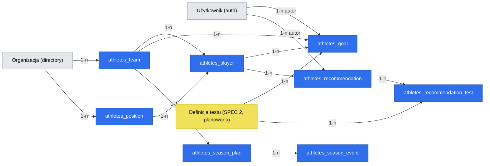

# E06 — Cele, zalecenia i klub

**Date**: 2026-10-28
**Status**: Ready for implementation — fazy 1–2; faza 3 zablokowana. Gotowość per faza:
- Faza 1 (klub): gotowa; zaczyna się weryfikacją kontraktu `auth` (krok 1).
- Faza 2 (cele drużyny/zawodnika, plan sezonu): gotowa po bramce wyjścia fazy 1.
- Faza 3 (cel testu, zalecenia): zablokowana tylko bramką fazy 1 specyfikacji `2026-10-28-e02-testy-i-wyniki.md` („Testy i wyniki”); Q-002 rozstrzygnięte 2026-10-31.

> Źródła: `.ai/specs/2026-10-22-prd.md` (Stories 13–15, NFR-001, NFR-004), epik [#6](https://github.com/mikolajjenczyk/test_athletica/issues/6), historie [#20](https://github.com/mikolajjenczyk/test_athletica/issues/20) (E06-S01), [#21](https://github.com/mikolajjenczyk/test_athletica/issues/21) (E06-S02), [#22](https://github.com/mikolajjenczyk/test_athletica/issues/22) (E06-S03), zadanie [#26](https://github.com/mikolajjenczyk/test_athletica/issues/26) (E06-S03-T01), prototyp `.ai/prototypes/discovery/Atletica-prototyp-lo-fi-rev-053/index.html`. Brak `product-brief.md` w tym repo — ids D/R/N/Q pochodzą z PRD.

## TLDR

Dziś operator ręcznie przypisuje każdemu użytkownikowi klub (D33), w repo nie ma modułu zawodników, a trener nie ma miejsca na cele, „Plan sezonu” ani zalecenia. Proponujemy (przyszłe zachowanie) moduł aplikacji `athletes`, w którym: (1) administrator klubu zakłada drużynę i zawodników oraz zaprasza trenera i dyrektora przez zainstalowany `auth`, a kluby — organizacje w `directory` — są od siebie odizolowane; (2) trener zapisuje cele i prosty „Plan sezonu”, które później czyta AI (D288); (3) trener daje zalecenie powiązane z testami i ocenia je, a dyrektor widzi stan bez tekstu trenera. Najmniejszy spójny wynik to faza 1: klub z drużyną, zawodnikami i zaproszonymi kontami, w pełnej izolacji.

## Problem Statement

- **Uruchomienie klubu wymaga operatora.** Dziś operator ustawia klub każdemu użytkownikowi ręcznie (PRD, Technical/Security; konflikt C20). Pilotaż 1–3 organizacji (D08) potrzebuje, żeby administrator klubu sam zaprosił trenera i dyrektora. Kluby nigdy nie widzą swoich danych, a przy niejasnym klubie dostęp jest odmówiony (D33, NFR-004). Zawodnicy to dzieci i nastolatki (NFR-001, R23).
- **AI nie zna intencji trenera.** Obserwacje AI mają czytać wyniki względem celów i planowanego okresu zmęczenia; bez „Plan sezonu” brak zmiany wygląda jak stagnacja (D288, D336). „Cel” testu jest osobnym punktem odniesienia na karcie zawodnika (R14).
- **Brak pętli uczenia się z zaleceń.** Trener chce dać zalecenie powiązane z testami i ocenić, czy zadziałało (D200, D246, D270); dyrektor widzi stan, nie tekst trenera (D265).
- **Dowody.** `[DOCUMENT]` — dokumenty klienta i relacja założyciela; żaden trener ani administrator klubu nie był słuchany. Panel syntetyczny z 2026-10-28 nie dotyczył tego epiku.

## Overview and Success Measures

- **Primary outcome:** klub pilotażowy uruchomiony bez operatora po założeniu organizacji: administrator zaprasza trenera i dyrektora, a ci logują się do własnego klubu — 100% klubów pilotażu (1–3).
- **Leading indicators:** zaproszenia przyjęte w ciągu 7 dni; drużyna z zawodnikami wprowadzona przed pierwszym testem; „Plan sezonu” wypełniony w drużynie przed pierwszymi obserwacjami AI.
- **Baseline:** dziś 0 klubów uruchamianych samodzielnie (operator ustawia klub ręcznie).
- **Market / product reference:** systemy zarządzania sportowcami (AMS, np. Smartabase, Kitman Labs, Teamworks — wiedza ogólna, bez weryfikacji źródeł w tym przebiegu). Przyjmujemy: zaproszenia per rola, cele per test i per zawodnik, kalendarz kluczowych wydarzeń. Odrzucamy: rozbudowaną periodyzację (makro/mezocykle) — D336 zakazuje planu miesiąc po miesiącu; konfigurowalne formularze — po MVP.

## Goals

- **REQ-001** — Administrator klubu zakłada jedną drużynę (D206), jej zawodników i pozycje, wyłącznie we własnym klubie.
- **REQ-002** — Administrator zaprasza osoby do własnego klubu z rolą trenera, dyrektora lub administratora; konta powstają tylko przez zaproszenie, a „Status konta” pokazuje oczekujące zaproszenia (R07, D204, C20).
- **REQ-003** — Dezaktywacja konta odbiera dostęp natychmiast, a ponowna aktywacja go przywraca; ostatniego aktywnego administratora klubu nie da się dezaktywować; zgrubny przepływ usuwania danych klubu kończy się potwierdzeniem (R26, D352).
- **REQ-004** — Użytkownik jednego klubu nigdy nie widzi ani nie zmienia danych innego klubu; przy niejasnym klubie dostęp jest odmówiony (D33, NFR-004).
- **REQ-005** — „Ukryj nazwiska” ukrywa nazwisko każdej osoby na ekranach tej specyfikacji (D184). Wspólny komponent wyświetlania nazwiska jest kontraktem, którego używają ekrany SPEC 2–8.
- **REQ-006** — Trener ustawia „Cel drużyny” i „Cel zawodnika” i sam je odhacza (D223, D226).
- **REQ-007** — Trener ustawia „Cel” na teście: wartość, termin, autor, powód (D223) — faza 3, po bramce wyjścia SPEC 2.
- **REQ-008** — Trener prowadzi „Plan sezonu”: początek sezonu (data), cel sezonu z datą, kluczowe wydarzenia (data, opcjonalna data końca, nazwa, flaga „planowane zmęczenie”), opcjonalny typowy tydzień jako zwykły edytowalny tekst, bez planu miesiąc po miesiącu (D336). Flagę czyta AI (D288); początek sezonu liczy „Zrealizowane: N z 6 · od <data>” w E02.
- **REQ-009** — Trener daje zalecenie powiązane z testami; każdy test ma własny stan; jedna ocena „Ocena realizacji i efektu zalecenia” w trzech polach tekstowych: „Realizacja”, „Efekt”, „Wnioski”; „Jeszcze nie można ocenić” zostawia je otwarte (D200, D246, D270).
- **REQ-010** — Dyrektor widzi przy zaleceniu testy, daty, stan i wybór oceny, ale nigdy tekstu trenera (D265).

## Non-goals

- Kilka drużyn w klubie i widok klubu — po MVP (D206); interfejs pokazuje kolejne drużyny jako „po MVP”.
- Konta zawodników i rodziców (N01); kontakt opiekuna nie jest przechowywany (Q5 → A).
- Zalecenia dla drużyny lub pozycji (czeka na klienta, D347); plan miesiąc po miesiącu (D336).
- Formalne polityki bezpieczeństwa w pilocie: harmonogramy retencji, reguły na poziomie pól, dzienniki zmian (D352).
- Twarde usuwanie danych z interfejsu — trwałe czyszczenie wykonuje operator (patrz Rollout).
- Treść oceny zalecenia generowana przez AI; AI tylko czyta cele i plan (E04).
- Własny mechanizm zaproszeń, haseł lub ról — używamy zainstalowanego `auth`.

## Proposed Solution

Nowy moduł aplikacji `athletes` (id z PRD, `src/modules/athletes/`), zbudowany przez `om-module-scaffold` na wzorcach `src/modules/example`. Klub to osobny tenant z jedną organizacją `directory` (Q4, zmienione 2026-10-28 po weryfikacji `auth` w kroku 1); izolację daje zakres tenanta i organizacji wyprowadzany z zaufanego kontekstu. Konta, hasła, zaproszenia, role i dezaktywacja zostają w zainstalowanym `auth`, które izoluje użytkowników per tenant — moduł dodaje trzy role klubowe z zestawami funkcji ACL i stronę „Status konta”, która woła API `auth`. Moduł posiada encje drużyny, pozycji, zawodnika, celów, planu sezonu i zaleceń. Jedna specyfikacja, trzy fazy (Q1). Fazy 1 i 2 nie zależą od innych specyfikacji. Faza 3 (cel testu i zalecenia) używa definicji i wyników testów z SPEC 2 („Testy i wyniki”, ten sam moduł) i startuje dopiero po jej bramce wyjścia — E06 jest więc dostarczany przed SPEC 2 (fazy 1–2) i po niej (faza 3).

### Design Decisions and Alternatives

| Decision | Rationale | Alternative considered | Why rejected / deferred |
|---|---|---|---|
| Klub = tenant z jedną organizacją `directory` (Q4, 2026-10-28) | Krok 1 wykazał, że przy jednym tenancie `/api/auth/users` dla nie-superadmina nie izoluje organizacji: POST tworzy konto w dowolnej organizacji tenanta, GET listuje użytkowników wszystkich organizacji; `auth` izoluje natywnie tylko tenant | Jeden tenant + własne API kont lub interceptory na `auth` | Własne API dublowałoby kontrakt `auth`; interceptory łatałyby instalowany kontrakt w trzech miejscach. Koszt: operator zakłada tenant per klub, raporty przekrojowe pilotażu robi superadmin |
| Zaproszenia przez `auth` (`POST /api/auth/users` z `sendInviteEmail`, `resend-invite`) | Instalowany kontrakt już waliduje cel organizacji i role (`assertCanAssignUserDestination`, `assertCanAssignRoles`) | Własna encja zaproszenia | Dublowałaby `auth` i tokeny; AGENTS.md: brak ad hoc kryptografii |
| Role klubowe jako szablony ról z zestawami funkcji ACL w `setup.ts` | Strażnicy sprawdzają funkcje, nie nazwy ról (AGENTS.md) | Sprawdzanie nazwy roli | Zabronione |
| Kilka ról na osobę (Q7 → A) | Mała akademia: administrator bywa trenerem | Jedna rola | Wymuszałaby drugie konto |
| „Ukryj nazwiska” jako przełącznik widoku użytkownika (Q6 → A) | Cel to prezentacja na ekranie; nie zmienia danych ani uprawnień | Ustawienie klubu | Wymagałoby uprawnień i maskowania w API bez zysku dla pilotażu |
| Imię, nazwisko i data urodzenia zawodnika szyfrowane (R23, NFR-001) | Dane małoletnich | Szyfrowanie tylko daty urodzenia | Niezgodne z NFR-001 |
| Ocena zalecenia w jednym rekordzie z trzema polami | D246: jedna ocena w trzech częściach | Osobna encja per część | Zbędna złożoność |
| Usuwanie klubu = miękkie usunięcie + dezaktywacja kont; trwałe czyszczenie przez operatora | R26/D352 wymagają tylko zgrubnego przepływu; trwałe usuwanie jest nieodwracalne | Twarde usuwanie z interfejsu | Zbyt ryzykowne bez polityki retencji (D352) |

## Domain Vocabulary and Business Rules

| Term / invariant | Precise meaning or rule | Source of truth | Failure behavior |
|---|---|---|---|
| Klub | Tenant z jedną organizacją `directory`; wszystkie rekordy modułu mają `tenant_id` i `organization_id` klubu | `directory` | Brak organizacji w kontekście → 403, nic nie zwrócone (D33) |
| Drużyna | Grupa zawodników jednego klubu; w MVP najwyżej jedna aktywna drużyna w klubie (D206) | `athletes_team` | Próba utworzenia drugiej aktywnej → 409 z komunikatem „po MVP” |
| Pozycja | Słownik pozycji klubu ustawiany przez administratora (D344) | `athletes_position` | Usunięcie pozycji używanej przez zawodnika → 409 |
| Zawodnik | Osoba małoletnia w jednej drużynie; `joined_at` ogranicza daty testów (D162) | `athletes_player` | `joined_at` w przyszłości → 400 |
| Rola klubowa | Szablon roli `auth` z zestawem funkcji `athletes.*`: administrator klubu, trener, dyrektor | `auth` + `setup.ts` | Brak funkcji → 403 |
| Konto oczekujące | Użytkownik `auth` utworzony z `sendInviteEmail`, który nie ustawił hasła (brak `passwordHash`; lista `auth` tego nie zwraca → `GET /api/athletes/accounts/invite-status`) | `auth` | Ponowne wysłanie przez `resend-invite`, limit 3 / 5 min |
| Konto nieaktywne | Użytkownik `auth` z `isConfirmed = false`; sesje i dostęp tracone natychmiast (R26) | `auth` | Logowanie odrzucone |
| Cel drużyny / zawodnika | Tekst z terminem, autorem i stanem `open`/`achieved`; odhacza trener (D226) | `athletes_goal` | Brak drużyny/zawodnika z tego klubu → 404 |
| Cel testu | Wartość liczbowa w jednostce testu, termin, autor, powód (D223); jeden aktywny cel na test i drużynę lub zawodnika | `athletes_goal` (`kind = test`) | Druga aktywna → 409 |
| Plan sezonu | Jeden na drużynę: początek sezonu, cel sezonu + data, lista kluczowych wydarzeń (data od, data do opcjonalnie, nazwa, flaga „planowane zmęczenie”), typowy tydzień jako tekst (D336) | `athletes_season_plan`, `athletes_season_event` | Data wydarzenia spoza sezonu jest dozwolona, bez blokady |
| Zalecenie | Rekomendacja trenera dla zawodnika, powiązana z 1+ testami; tekst trenera tylko dla trenera (D265) | `athletes_recommendation` | Brak testów → 400 |
| Stan testu w zaleceniu | Wyliczany z wyników SPEC 2 po dacie zalecenia: „czeka”, „wykonany <data>”, „termin minął” — nie przechowywany | SPEC 2 wyniki | Brak wyników → „czeka” |
| Ocena zalecenia | Trzy części (D246) + wybór: oceniona / „Jeszcze nie można ocenić” (zostaje otwarte, D270) | `athletes_recommendation` | — |

## Users, Permissions, and Scope

| Actor | Allowed outcomes | Scope rule | Required feature IDs |
|---|---|---|---|
| Operator (administrator systemu) | Zakłada tenant klubu z organizacją i pierwszego administratora klubu (rola `club_admin`), potem `yarn mercato auth sync-role-acls`; trwale czyści dane klubu | system (instalowany kontrakt `directory`/`auth`, superadmin) | instalowane `directory.*`, `auth.users.*` |
| Administrator klubu | Drużyna, pozycje, zawodnicy; zaproszenia, „Status konta”, dezaktywacja; usunięcie danych klubu | własna organizacja | `athletes.club.manage`, `athletes.players.view`, `athletes.players.manage`, `auth.users.list`, `auth.users.create`, `auth.users.edit` |
| Trener | Podgląd drużyny i zawodników; cele, plan sezonu, zalecenia i ich ocena | własna organizacja | `athletes.players.view`, `athletes.goals.manage`, `athletes.plan.manage`, `athletes.recommendations.manage` |
| Dyrektor | Podgląd drużyny, celów, planu, zaleceń bez tekstu trenera | własna organizacja | `athletes.players.view`, `athletes.goals.view`, `athletes.plan.view`, `athletes.recommendations.view` |

`tenantId` i `organizationId` pochodzą zawsze z kontekstu uwierzytelnionego żądania; pola o tych nazwach w ciele lub zapytaniu są ignorowane. Użytkownik bez organizacji w kontekście dostaje 403 (fail closed). Tekst trenera w zaleceniu wymaga `athletes.recommendations.manage` — odpowiedź dla samego `.view` go pomija (nie maskuje). Jedyna operacja w zakresie systemowym to onboarding klubu przez operatora na zainstalowanych kontraktach `directory`/`auth`.

## Reuse and Ownership Map

| Capability | Reuse / extend / app-own | Existing module or new module | Integration seam | Why |
|---|---|---|---|---|
| Klub | reuse | `directory` (organizacja) | `organization_id` z kontekstu | Natywny zakres izolacji |
| Konta, zaproszenia, hasła, dezaktywacja | reuse | `auth` | `POST/PUT /api/auth/users`, `POST /api/auth/users/resend-invite` | Źródło prawdy dla tożsamości |
| Role klubowe | extend | `auth` role + `athletes/setup.ts` | funkcje ACL `athletes.*` w szablonach ról | Bez strażników po nazwie roli |
| Drużyna, pozycja, zawodnik | app-own | `athletes` | encje modułu | Domena aplikacji |
| Cele, plan sezonu, zalecenia | app-own | `athletes` | encje modułu | Domena aplikacji |
| Definicja testu i wyniki | app-own (inna specyfikacja) | `athletes` (SPEC 2) | `test_definition_id` w tym samym module | Fazy 2–3 czekają na SPEC 2 |
| Autor celu/zalecenia | reuse | `auth` | `author_user_id` + migawka `author_name` | Nazwa autora przetrwa dezaktywację |
| Dziennik zmian | reuse | `audit_logs` | komendy z undo | Bez własnego dziennika |

## Architecture and Data Flow

```text
Administrator klubu -> /backend/club, /players -> athletes commands -> athletes_team / _position / _player
                    -> /backend/accounts -> POST /api/auth/users (sendInviteEmail, organizationId = kontekst)
                                                       -> PUT /api/auth/users (isConfirmed=false)
Trener -> /backend/goals, /season-plan, /recommendations -> athletes commands -> athletes_goal / _season_plan / _recommendation
                                                                 -> athletes.*.created|updated|deleted (po commicie)
Dyrektor -> te same strony w trybie podglądu -> GET (bez coach_text)
E04 (później) -> czyta cele i plan przez API/serwis modułu
```

- **Module boundaries:** jeden moduł `athletes` dla drużyny, zawodników, celów, planu, zaleceń i (w SPEC 2) testów — cele i zalecenia wskazują definicje testów i zawodników, więc muszą być spójne transakcyjnie i w jednym zakresie.
- **Extension points:** zainstalowane API `auth` przez wspólne helpery API; brak modyfikacji kodu zainstalowanego. Jeśli „Status konta” wymaga pola oczekującego zaproszenia, którego API `auth` nie zwraca — enricher odpowiedzi `auth.user` (host `entity:auth.user`, zakres tenant-and-organization, STABLE) zamiast własnej tabeli.
- **Alternatives considered:** strona użytkowników `auth/backend/users` zamiast własnej „Status konta” — odrzucona dla administratora klubu, bo pokazuje pola i role całego systemu; zostaje dla operatora.
- **Compatibility:** nowe trasy, encje, zdarzenia i funkcje ACL — tylko dodawane; żadna zmiana zainstalowanych kontraktów.

## User Journeys

### Journey J-001 — Uruchomienie klubu

1. Operator zakłada organizację klubu w `directory` i zaprasza pierwszego administratora klubu (zainstalowane strony).
2. Administrator ustawia hasło z zaproszenia, wchodzi na „Profil klubu” (`/backend/club`), zakłada drużynę i pozycje.
3. Administrator dodaje zawodników (`/backend/players/create`) — imię, nazwisko, data urodzenia, pozycja, data dołączenia.
4. Błąd: druga aktywna drużyna → komunikat „Kolejne drużyny po MVP” (409); konflikt edycji → komunikat i ponowne wczytanie (409).

### Journey J-002 — Zaproszenie i dezaktywacja

1. Administrator otwiera „Status konta” (`/backend/accounts`), klika „Zaproś”, podaje e-mail, imię i rolę klubową.
2. System tworzy użytkownika w `auth` w organizacji administratora z `sendInviteEmail`; lista pokazuje „Zaproszenie oczekuje”.
3. Zaproszony ustawia hasło; status zmienia się na „Aktywne”. Administrator może ponowić zaproszenie (limit) albo dezaktywować konto — dostęp znika natychmiast.
4. Błąd: e-mail już istnieje w innym klubie → komunikat bez ujawniania, który to klub; próba nadania roli spoza trzech ról klubowych → 403.

### Journey J-003 — Cele i plan sezonu

1. Trener na stronie drużyny „Cele” dodaje „Cel drużyny”, „Cel zawodnika” lub (po SPEC 2) „Cel” na teście.
2. Trener odhacza cel osiągnięty; „Plan sezonu” edytuje jako tekst z listą kluczowych wydarzeń.
3. Dyrektor widzi cele i plan w trybie podglądu.
4. Błąd: dyrektor próbuje edytować → brak akcji w UI i 403 w API.

### Journey J-004 — Zalecenie i ocena

1. Trener na karcie zawodnika lub w „Zalecenia” tworzy zalecenie, wybiera testy z zestawu (SPEC 2) i pisze tekst dla siebie.
2. Każdy test pokazuje stan wyliczony z wyników; trener wypełnia ocenę w trzech częściach albo wybiera „Jeszcze nie można ocenić”.
3. Dyrektor widzi testy, daty, stan i wybór oceny, bez tekstu trenera.
4. Błąd: konflikt wersji przy ocenie → 409 z ponownym wczytaniem.

## UI and Interaction Contracts

Referencje: `.ai/guides/backend-ui.md`, `node_modules/@open-mercato/core/src/modules/auth/backend/users` (lista kont z `DataTable`), wzorce `example` (`ui.page-shell`, `ui.datatable`, `ui.form-create`, `ui.form-edit`), prototyp rev-053 (ekrany „Profil klubu”, „Status konta”, „Cele”, „Plan sezonu”, „Zalecenia”). Wszystkie teksty po polsku w `src/modules/athletes/i18n/pl.json` (+ `en.json`).

| Surface / route | Purpose and primary actions | Data source / mutations | Closest installed reference | Canonical shell / components | Required states | Requirement IDs |
|---|---|---|---|---|---|---|
| `/backend/club` | „Profil klubu”: nazwa klubu, drużyna, pozycje; utwórz/edytuj drużynę | `GET/POST/PUT /api/athletes/teams`, `/api/athletes/positions` | `example/backend/todos/page.tsx` | `Page`, `PageBody`, `CrudForm`, `DataTable` | loading, empty („Załóż drużynę”), error, conflict, permission denied | REQ-001, REQ-004 |
| `/backend/players` (+ `/create`, `/[id]/edit`) | Lista i edycja zawodników | `/api/athletes/players` | `example/components/TodosTable.tsx`, `TodoForm.tsx` | `DataTable`, `CrudForm` | j.w. + walidacja dat | REQ-001, REQ-004, REQ-005 |
| `/backend/accounts` | „Status konta”: konta klubu, statusy, „Zaproś”, „Wyślij ponownie”, „Dezaktywuj” | `GET/POST/PUT /api/auth/users`, `POST /api/auth/users/resend-invite` | `auth/backend/users` | `DataTable`, dialog `CrudForm`, potwierdzenie destrukcyjne | j.w. + limit ponowień | REQ-002, REQ-003 |
| `/backend/accounts/delete-club` | Zgrubne usunięcie danych klubu z potwierdzeniem (wpisanie nazwy klubu) | `POST /api/athletes/club/delete-request` | potwierdzenia destrukcyjne w `auth/backend/users/[id]` | `Page`, dialog potwierdzenia | error, success, permission denied | REQ-003 |
| `/backend/goals` | „Cele”: cele drużyny, zawodników i testów; odhaczanie | `/api/athletes/goals` | `example/components/TodosTable.tsx` | `DataTable`, `CrudForm` | j.w.; tryb podglądu dla dyrektora | REQ-006, REQ-007 |
| `/backend/season-plan` | „Plan sezonu”: cel sezonu, wydarzenia, typowy tydzień | `/api/athletes/season-plans`, `/api/athletes/season-events` | `example/backend/todos/[id]/edit/page.tsx` | `CrudForm`, `DataTable` (wydarzenia) | j.w. | REQ-008 |
| `/backend/recommendations` (+ `/create`, `/[id]`) | Zalecenia, testy ze stanem, ocena | `/api/athletes/recommendations` | `example/components/TodosTable.tsx`, `TodoForm.tsx` | `DataTable`, `CrudForm` | j.w.; dyrektor bez tekstu trenera | REQ-009, REQ-010 |

Odwołania do rekordów (drużyna, pozycja, zawodnik, test, rola klubowa) to kontrolki wyboru zasilane trasami opcji modułu (`/api/athletes/options/{teams|positions|players|tests}`), wzór `example/api/tags/route.ts`; role klubowe — stała lista trzech ról.

### UI architecture

| Role | Navigation groups in order | Dashboard / injected widgets | Login-to-primary-task flow |
|---|---|---|---|
| Administrator klubu | Klub → Profil klubu, Zawodnicy, Status konta | brak | logowanie → Profil klubu (pytanie 6 do Toma) → „Zaproś” (≤ 3 kliknięcia) |
| Trener | Drużyna → Zawodnicy, Cele, Plan sezonu, Zalecenia | brak (Pulpit w SPEC 7) | logowanie → Cele → „Dodaj cel” |
| Dyrektor | Drużyna → Cele, Zalecenia (podgląd) | brak | logowanie → Zalecenia → podgląd |

| Surface / widget | Empty state guidance and action | Responsive behavior | Keyboard / focus behavior |
|---|---|---|---|
| Profil klubu | „Załóż drużynę, aby dodać zawodników” + przycisk | administrator tylko na komputerze (D344); poniżej 1024 px komunikat „Użyj komputera” | fokus na pierwszym polu formularza, Esc zamyka dialog |
| Status konta | „Nikt jeszcze nie został zaproszony” + „Zaproś” | j.w. | potwierdzenie dezaktywacji z fokusem na „Anuluj” |
| Cele / Plan / Zalecenia | lokalizowane wyjaśnienie + akcja główna | telefon 390 px: lista jednokolumnowa, cele dotyku 44 px (NFR-007) | Enter zapisuje, Esc anuluje, komunikaty przez region live |

### `/backend/accounts` — Status konta

```text
┌────────────────────────────────────────────────────────────┐
│ Status konta                                   [Zaproś]    │
│ Filtry: rola · status                                      │
├────────────────────────────────────────────────────────────┤
│ Osoba        Rola             Status                Akcje  │
│ A. Nowak     Trener           Aktywne               ⋯      │
│ B. Kowalska  Dyrektor         Zaproszenie oczekuje  ⋯      │
├────────────────────────────────────────────────────────────┤
│ Paginacja · komunikaty statusu                             │
└────────────────────────────────────────────────────────────┘
```

- **Behavior:** akcje wiersza: „Wyślij ponownie” (tylko oczekujące; 429 → komunikat o limicie), „Dezaktywuj” (potwierdzenie), „Aktywuj ponownie”. Administrator nie może dezaktywować ostatniego aktywnego administratora klubu (409).
- **Responsive and accessibility:** status zawsze tekstem, nie samym kolorem (NFR-006).
- **Localization:** `athletes.accounts.*`.
- **Design-system and theming:** tokeny semantyczne statusu z systemu projektowego; jasny i ciemny motyw.

### `/backend/recommendations/[id]` — Zalecenie

```text
┌────────────────────────────────────────────────────────────┐
│ Zalecenie · {zawodnik} · {data}                [Zapisz]    │
├────────────────────────────────────────────────────────────┤
│ Testy: CMJ — wykonany 12.11 · Sprint 10 m — czeka          │
│ Tekst trenera (widzi tylko trener)                         │
│ Ocena realizacji i efektu: Realizacja · Efekt · Wnioski     │
│ ( ) Oceniona  ( ) Jeszcze nie można ocenić                 │
└────────────────────────────────────────────────────────────┘
```

- **Behavior:** pole tekstu trenera ma etykietę odbiorcy (FR-003); u dyrektora sekcja tekstu nie istnieje w DOM; konflikt 409 → baner z „Wczytaj ponownie”.

Każda strona: `om-backend-ui-design` przy implementacji, brak surowych tabel/formularzy/`fetch`, brak twardych kolorów statusu.

„Ukryj nazwiska” (REQ-005): przełącznik na stronach „Zawodnicy” i „Status konta” (menu profilu jest powierzchnią instalowanego modułu — wstrzyknięcie przez UMES odłożone), stan zapisany per użytkownik w pamięci przeglądarki (klucz z id użytkownika, z obsługą wyjątków); wspólny komponent wyświetlania nazwiska modułu zamienia nazwiska na inicjały lub „Zawodnik 12”. To ustawienie wyłącznie prezentacyjne — nie jest zabezpieczeniem i nie zmienia odpowiedzi API.

## Data Models

Wszystkie encje w `src/modules/athletes/data/entities.ts`: UUID `id`, `tenant_id`, `organization_id` (indeks złożony), `created_at`, `updated_at` (wersja blokady optymistycznej), `deleted_at` (miękkie usunięcie). Brak relacji ORM do innych modułów — tylko id i migawki.

### `athletes_team`

| Field | Type / nullability | Scope / index | Sensitive / encrypted | Lifecycle and validation |
|---|---|---|---|---|
| `name` | text, required | unikalne w organizacji (bez usuniętych) | no | 1–80 znaków |
| `is_active` | bool, required | częściowy unikalny indeks: jedna aktywna drużyna na organizację (D206) | no | — |

### `athletes_position`

| Field | Type / nullability | Scope / index | Sensitive / encrypted | Lifecycle and validation |
|---|---|---|---|---|
| `name` | text, required | unikalne w organizacji | no | 1–40 znaków |
| `sort_order` | int, required | — | no | ≥ 0 |

### `athletes_player`

| Field | Type / nullability | Scope / index | Sensitive / encrypted | Lifecycle and validation |
|---|---|---|---|---|
| `team_id` | UUID, required | indeks (org, team) | no | drużyna z tej samej organizacji |
| `first_name`, `last_name` | text, required | — | **tak** (mapa szyfrowania) | 1–60 znaków; sortowanie po stronie klienta w drużynie (≤ 35 osób) |
| `birth_date` | date, required | — | **tak** | w przeszłości |
| `position_id` | UUID, nullable | — | no | pozycja z tej samej organizacji |
| `joined_at` | date, required | — | no | nie w przyszłości; ogranicza daty testów (D162) |
| `is_active` | bool, required | — | no | nieaktywny znika z list domyślnych |

### `athletes_goal`

| Field | Type / nullability | Scope / index | Sensitive / encrypted | Lifecycle and validation |
|---|---|---|---|---|
| `kind` | enum `team`/`player`/`test`, required | — | no | faza 2 tworzy `team`/`player`; `test` i kolumny `test_definition_id`, `target_value`, `unit` z indeksem dodaje migracja fazy 3 |
| `team_id` | UUID, required | indeks (org, team) | no | — |
| `player_id` | UUID, nullable | — | no | wymagany dla `player`, opcjonalny dla `test` |
| `test_definition_id` | UUID, nullable | częściowy unikalny: jeden aktywny cel (org, team/player, test) | no | wymagany dla `test` |
| `title` | text, nullable | — | no | wymagany dla `team`/`player`, 1–200 |
| `target_value`, `unit` | decimal / text, nullable | — | no | wymagane dla `test`; jednostka z definicji testu |
| `deadline` | date, required | — | no | — |
| `reason` | text, nullable | — | no | ≤ 500 |
| `author_user_id`, `author_name` | UUID + migawka, required | — | no | z kontekstu |
| `status`, `achieved_at` | enum `open`/`achieved`, timestamp | — | no | odhacza trener (D226) |

### `athletes_season_plan` i `athletes_season_event`

| Field | Type / nullability | Scope / index | Sensitive / encrypted | Lifecycle and validation |
|---|---|---|---|---|
| plan: `team_id` | UUID, required | unikalne (org, team) | no | jeden plan na drużynę |
| plan: `season_starts_on`, `season_goal`, `season_goal_date` | date null, text, date | — | no | tekst ≤ 2000; `season_starts_on` używa E02 (licznik „Zrealizowane”) |
| plan: `typical_week` | text, nullable | — | no | ≤ 4000, zwykły tekst |
| event: `plan_id`, `starts_on`, `ends_on`, `label`, `is_planned_fatigue` | UUID, date, date null, text, bool | indeks (org, plan) | no | `ends_on ≥ starts_on`; `is_planned_fatigue` czyta AI (D288, Q-003) |

### `athletes_recommendation` i `athletes_recommendation_test`

| Field | Type / nullability | Scope / index | Sensitive / encrypted | Lifecycle and validation |
|---|---|---|---|---|
| `player_id` | UUID, required | indeks (org, player) | no | — |
| `issued_on` | date, required | — | no | — |
| `coach_text` | text, nullable | — | **tak** (notatka o małoletnim, tylko trener) | ≤ 4000; pomijany w odpowiedziach bez `.manage` |
| `review_realization`, `review_effect`, `review_conclusions` | text, nullable | — | tak | trzy pola tekstowe oceny (D246, Q-002); etykiety „Realizacja”, „Efekt”, „Wnioski” |
| `review_choice` | enum `none`/`reviewed`/`not_yet`, required | — | no | `not_yet` zostawia zalecenie otwarte (D270) |
| `author_user_id`, `author_name` | UUID + migawka | — | no | z kontekstu |
| link: `recommendation_id`, `test_definition_id` | UUID | unikalne para | no | ≥ 1 test na zalecenie |



Relacje do organizacji i użytkownika to id w zakresie (bez relacji ORM). Widok HTML w `.ai/data-model/` pominięty — diagram Mermaid jest dokumentem wiążącym. Migracje: `yarn db:generate` po każdej fazie, przegląd SQL i snapshotu, zastosowanie dopiero po zgodzie (AGENTS.md).

## API, Command, and Error Contracts

Wszystkie trasy modułu przez `makeCrudRoute` z per-metodową `metadata` i eksportem `openApi`; zapisy przez komendy z undo (`athletes.<entity>.create|update|delete`); edycje wysyłają `updatedAt`, konflikt → 409.

| Method / command | Path / ID | Auth and feature gate | Input | Success response / event | Errors and concurrency | Requirement IDs |
|---|---|---|---|---|---|---|
| `GET/POST/PUT/DELETE` | `/api/athletes/teams` | `athletes.players.view` / `athletes.club.manage` | `{ name, isActive }` | `athletes.team.created|updated|deleted` | 400, 403, 409 (druga aktywna, wersja) | REQ-001, REQ-004 |
| `GET/POST/PUT/DELETE` | `/api/athletes/positions` | j.w. | `{ name, sortOrder }` | `athletes.position.*` | 409 (używana) | REQ-001 |
| `GET/POST/PUT/DELETE` | `/api/athletes/players` | `athletes.players.view` / `athletes.players.manage` | `{ teamId, firstName, lastName, birthDate, positionId?, joinedAt, isActive }` | `athletes.player.*` (bez nazwisk w ładunku) | 400 (daty), 403, 409 | REQ-001, REQ-004 |
| `GET` | `/api/athletes/options/{teams,positions,players}` (faza 1); `/options/tests` dostarcza SPEC 2, używa faza 3 | `athletes.players.view` | `q`, `limit` | `{ items: [{ id, label }] }` | 403 | REQ-001 |
| reuse | `POST /api/auth/users` | `auth.users.create` | `{ email, name, organizationId: (organizacja klubu z sesji), roles: [rola klubowa], sendInviteEmail: true }` | 201 `{ id }` | 400, 403 (tenant/rola — instalowani strażnicy: rola z funkcjami spoza uprawnień wołającego jest odrzucana), 409 | REQ-002, REQ-004 |
| reuse | `PUT /api/auth/users` | `auth.users.edit` | `{ id, isConfirmed }` | `{ ok }` | 403, 409, 400 (ostatni aktywny `club_admin` — instalowany strażnik `minActiveHolders = 1` zwraca 400 z przetłumaczonym komunikatem) | REQ-003 |
| `GET` | `/api/athletes/accounts/invite-status?ids=` | `auth.users.list` | `ids` (≤ 100) | `{ items: [{ id, pending }] }` — tylko użytkownicy tenanta i organizacji wołającego | 400, 403 | REQ-002 |
| reuse | `POST /api/auth/users/resend-invite` | j.w. | `{ id }` | `{ ok }` | 429 (3 / 5 min) | REQ-002 |
| `POST` | `/api/athletes/club/delete-request` | `athletes.club.manage` | `{ confirmationName }` | 202; komenda `athletes.club.soft_delete` — miękkie usunięcie rekordów modułu + dezaktywacja kont klubu poza wykonującym | 400 (nazwa się nie zgadza), 403 | REQ-003 |
| `GET/POST/PUT/DELETE` | `/api/athletes/goals` | `athletes.goals.view` / `.manage` | `{ kind, teamId, playerId?, testDefinitionId?, title?, targetValue?, unit?, deadline, reason?, status }` | `athletes.goal.*` | 400, 403, 409 | REQ-006, REQ-007 |
| `GET/POST/PUT` | `/api/athletes/season-plans`, `/api/athletes/season-events` | `athletes.plan.view` / `.manage` | plan / wydarzenie | `athletes.season_plan.*` | 400, 403, 409 | REQ-008 |
| `GET/POST/PUT/DELETE` | `/api/athletes/recommendations` | `athletes.recommendations.view` / `.manage` | `{ playerId, issuedOn, testDefinitionIds[], coachText?, review*, reviewChoice }` | odpowiedź bez `coachText`/`review*` tekstu dla `.view`; `athletes.recommendation.*` | 400, 403, 409 | REQ-009, REQ-010 |

Uwaga do `POST /api/auth/users`: `organizationId` jest polem kontraktu `auth`; zainstalowany strażnik `assertCanAssignUserDestination` waliduje je względem uprawnień wołającego. Faza 1 zaczyna się od weryfikacji (`om-framework-context`), że administrator klubu nie może wskazać cudzej organizacji ani roli spoza dozwolonych — jeśli nie, dodajemy interceptor API `auth` (wzorzec `umes.mutation-guard`) wymuszający organizację z kontekstu.

## Events, Jobs, Notifications, and Cross-Module Flows

| Trigger | Producer | Consumer | Side effect | Retry / idempotency / audit behavior |
|---|---|---|---|---|
| `athletes.{team,position,player,goal,season_plan,recommendation}.{created,updated,deleted}` | `athletes` | `audit_logs`; w przyszłości E04 (cache kontekstu AI) | dziennik, przyszłe unieważnianie | emitowane po commicie; ładunek bez nazwisk i tekstów |
| `athletes.club.soft_deleted` | `athletes` | brak w tej specyfikacji | — | jednorazowe; ponowne żądanie idempotentne |
| zaproszenie | `auth` (instalowane) | e-mail `auth` | wiadomość z linkiem | limit instalowany |

Brak zadań w tle i powiadomień w tej specyfikacji.

## Security, Privacy, and Compliance

- **Authorization:** funkcje `athletes.*` per metoda; role klubowe tylko jako szablony w `setup.ts`, bez sprawdzania nazw ról.
- **Tenant isolation:** każdy odczyt i zapis filtruje `tenant_id` + `organization_id` z kontekstu; referencje (`team_id`, `position_id`, `player_id`, `test_definition_id`) walidowane w tym samym zakresie; brak organizacji → 403; testy dwóch klubów (TEST-002).
- **Sensitive data:** `first_name`, `last_name`, `birth_date`, `coach_text`, `review_part_*` w mapie szyfrowania modułu; odczyty przez `findWithDecryption`; zdarzenia i logi bez tych pól. Przegląd prawny danych małoletnich przed prawdziwymi danymi klubu — pytanie 3 do Toma (zależność poza produktem).
- **Abuse and failure modes:** wyliczanie e-maili przy zaproszeniu (komunikat neutralny), limit ponowień (instalowany), usunięcie klubu wymaga wpisania nazwy, ostatni administrator nie może się dezaktywować.

## Integration Coverage

| Test ID | Level | Setup / fixture | Actions | Assertions | Requirement IDs |
|---|---|---|---|---|---|
| TEST-001 | integration | klub A, administrator | API: drużyna, pozycje, zawodnik | zapis, zaszyfrowane kolumny w bazie, zdarzenia po commicie | REQ-001 |
| TEST-002 | security | kluby A i B | administrator/trener A czyta i zmienia rekordy B; wołanie bez organizacji | 404/403, brak danych B w odpowiedziach | REQ-004 |
| TEST-003 | integration | administrator A | zaproszenie trenera, ponowienie, dezaktywacja | użytkownik w organizacji A z rolą, `isConfirmed=false` blokuje sesję | REQ-002, REQ-003 |
| TEST-004 | security | administrator A | zaproszenie do organizacji B / z rolą operatora | 403 | REQ-002, REQ-004 |
| TEST-005 | integration | klub z danymi | żądanie usunięcia ze złą i dobrą nazwą | 400; potem rekordy miękko usunięte, konta dezaktywowane | REQ-003 |
| TEST-006 | UI | zawodnicy | „Ukryj nazwiska” na listach i formularzach | brak nazwisk w DOM widoku | REQ-005 |
| TEST-007 | integration | trener, drużyna | cele drużyny/zawodnika, odhaczenie, konflikt wersji | stan `achieved`, 409 przy starej wersji | REQ-006 |
| TEST-008 | integration | SPEC 2: definicje testów | cel testu, druga aktywna | zapis; 409 | REQ-007 |
| TEST-009 | integration | trener | plan sezonu i wydarzenia, dyrektor edytuje | zapis; 403 dla dyrektora | REQ-008 |
| TEST-010 | security | trener, dyrektor, zalecenie z tekstem | GET jako dyrektor | brak `coachText` i tekstów oceny w odpowiedzi i w DOM | REQ-009, REQ-010 |
| TEST-011 | UI | strony fazy | stany loading/empty/error/conflict, klawiatura, 360 px, jasny/ciemny | obserwowalne stany | wszystkie |

Ścieżki: `.ai/qa/tests/athletes/*.spec.ts` (runner repozytorium, `om-integration-tests`).

## Implementation Phases

### Phase 1 — Klub, drużyna, zawodnicy i konta (E06-S03 #22, E06-S03-T01 #26)

- **Depends on:** Q15 (zakres klienta — zatwierdzony 2026-10-28); weryfikacja kontraktu `auth` (krok 1)
- **Outcome:** administrator klubu sam uruchamia klub: drużyna, pozycje, zawodnicy, zaproszeni trener i dyrektor; kluby odizolowane.
- **Why this order / value delivered:** każda kolejna specyfikacja (SPEC 2–8) potrzebuje zawodnika, drużyny i ról.
- **Deliverables:** kroki 1–7 poniżej.
- **Independent slices / estimated commits:** (a) encje + komendy + API, (b) ACL + setup ról, (c) strony klubu i zawodników, (d) „Status konta” + usuwanie — (c) i (d) równolegle po (a)+(b); ~7 commitów.
- **Requirements closed:** REQ-001…REQ-005
- **Tests:** TEST-001…TEST-006, TEST-011
- **Validation:** `yarn generate`, `yarn db:generate` (przegląd, bez stosowania), `yarn typecheck`, `yarn lint`, `yarn ds:check`, `yarn test`, `yarn test:integration:ephemeral`
- **Exit gate:** J-001 i J-002 przechodzą na dwóch klubach; brak przecieku między klubami; strony w jasnym/ciemnym motywie i 1024 px.

Kroki:
1. Weryfikacja `auth` przez `om-framework-context`: czy `POST /api/auth/users` odrzuca cudzą organizację i rolę dla administratora klubu; jakie pole oznacza zaproszenie oczekujące; czy `isActive=false` unieważnia sesje; czy snapshoty undo i wpisy `audit_logs` dla zaszyfrowanych pól zawodnika zostają zaszyfrowane (jeśli nie — komendy zapisują w snapshotach tylko id i pola niewrażliwe). Wynik zapisany w tej specyfikacji; brakujące gwarancje → interceptor/enricher (Architecture).
   **Wynik (2026-10-28):** przy jednym tenancie POST/GET `/api/auth/users` nie izolują organizacji dla nie-superadmina → klub = tenant (Q4). W tenancie klubu: rola z funkcjami spoza uprawnień wołającego (`admin`, `superadmin`) jest odrzucana przez `assertActorCanGrantRoles`; `isConfirmed=false` usuwa sesje i każde żądanie sprawdza konto; ochrona ostatniego administratora = `minActiveHolders = 1` na roli `club_admin` (instalowane `enforceProtectedRoleFloor`); oczekujące zaproszenie = brak `passwordHash` (trasa `invite-status`); ponowienie: 3 / 5 min per IP, 409 gdy hasło ustawione; snapshoty undo w `audit_logs` szyfrowane w spoczynku przy włączonym szyfrowaniu tenanta.
2. Moduł `athletes` (`index.ts`, `acl.ts`, `setup.ts` z trzema szablonami ról), aktywacja w `src/modules.ts`, `yarn generate`.
3. Encje `athletes_team`, `athletes_position`, `athletes_player` + mapa szyfrowania + walidatory + migracja (do przeglądu).
4. Komendy z undo i trasy `makeCrudRoute` + `openApi` + trasy opcji.
5. Strony „Profil klubu” i „Zawodnicy” (`om-backend-ui-design`), i18n pl/en, „Ukryj nazwiska”.
6. „Status konta”: lista, zaproszenie, ponowienie, dezaktywacja, ochrona ostatniego administratora.
7. Zgrubne usunięcie danych klubu + testy TEST-001…TEST-006, TEST-011.

### Phase 2 — Cele drużyny i zawodnika oraz „Plan sezonu” (E06-S01 #20, bez celu testu)

- **Depends on:** Phase 1 exit gate
- **Outcome:** trener zapisuje cele drużyny i zawodnika oraz plan sezonu z wydarzeniami; dyrektor je widzi.
- **Why this order / value delivered:** E04 (obserwacje AI) czyta plan i cele (D288) — muszą istnieć przed SPEC 5; nie zależy od SPEC 2.
- **Deliverables:** `athletes_goal` (`kind` `team`/`player`), `athletes_season_plan` (z `season_starts_on`), `athletes_season_event` (z flagą `is_planned_fatigue`), komendy, trasy, strony „Cele” i „Plan sezonu”.
- **Independent slices / estimated commits:** cele i plan równolegle; ~3 commity.
- **Requirements closed:** REQ-006, REQ-008
- **Tests:** TEST-007, TEST-009, TEST-011
- **Validation:** jak w fazie 1
- **Exit gate:** J-003 przechodzi dla celów drużyny i zawodnika oraz planu; dyrektor ma tylko podgląd.

### Phase 3 — Cel testu i zalecenia (E06-S01 #20 część testowa, E06-S02 #21)

- **Depends on:** Phase 2 exit gate, **bramka fazy 1 specyfikacji `2026-10-28-e02-testy-i-wyniki.md`** (definicje i wyniki testów, `/api/athletes/options/tests`, `athletesTestResultsService`). Kolejność dostawy: E06 faza 1 → E02 faza 1 → E06 faza 3.
- **Outcome:** trener ustawia cel na teście, daje i ocenia zalecenia; dyrektor widzi stan zalecenia bez tekstu trenera.
- **Why this order / value delivered:** cel testu i stan testu w zaleceniu wymagają definicji i wyników z SPEC 2; zamyka pętlę uczenia się.
- **Deliverables:** migracja dodająca `kind = test`, `test_definition_id`, `target_value`, `unit` i indeks do `athletes_goal`; `athletes_recommendation`, `athletes_recommendation_test`; wyliczanie stanu testu z wyników SPEC 2; strony „Zalecenia” i szczegół; pomijanie tekstów dla `.view`.
- **Independent slices / estimated commits:** cel testu i zalecenia równolegle; ~4 commity.
- **Requirements closed:** REQ-007, REQ-009, REQ-010
- **Tests:** TEST-008, TEST-010, TEST-011
- **Validation:** jak w fazie 1
- **Exit gate:** cel testu pokazuje jednostkę z definicji testu; J-004 przechodzi; TEST-010 potwierdza brak tekstu trenera w odpowiedzi i DOM dyrektora.

## Implementation Status

| Phase | State | Evidence |
|---|---|---|
| 1 | implemented, pending verification in app | branch `feat/e06-phase-1-club`: moduł `athletes` (encje, komendy z undo, trasy CRUD/opcje/`invite-status`/`club/delete-request`, role klubowe, strony `/backend/club`, `/backend/players`, `/backend/accounts`, `/backend/accounts/delete-club`); testy jednostkowe 10/10; test API `.ai/qa/tests/athletes/TC-ATH-001` napisany, nieuruchomiony (brak środowiska); migracja wygenerowana, niezastosowana |

Próba weryfikacji fazy 1 (2026-10-31): `yarn test:integration:ephemeral --filter athletes` zbudował środowisko i uruchomił aplikację, ale runner nie uznał jej za gotową — sonda gotowości w `@open-mercato/cli` wymaga `GET /api/customers/people` (200), a moduł `customers` nie jest włączony (404). Sonda nie jest konfigurowalna. Faza 1 pozostaje niezweryfikowana; odblokowanie wymaga decyzji: włączyć `customers` na potrzeby testów, zmienić narzędzie upstream albo zaakceptować inną ścieżkę weryfikacji (AGENTS.md: „Never migrate to validate”).

| 2 | pending | — |
| 3 | blocked | bramka fazy 1 E02 |

Odchylenia fazy 1: strona „Profil klubu” nie pokazuje nazwy klubu (nazwa widoczna na stronie usuwania danych); stan „Zaproszenie oczekuje” i filtry „Status konta” liczone po stronie klienta (klub ma kilka kont).

## Requirement Traceability

| Requirement | Journey / surface | Data/API/event contracts | Phase | Tests | Acceptance criterion |
|---|---|---|---|---|---|
| REQ-001 | J-001, `/backend/club`, `/players` | `athletes_team`, `_position`, `_player`; `/api/athletes/teams|positions|players` | 1 | TEST-001 | AC-001 |
| REQ-002 | J-002, `/club/accounts` | `POST /api/auth/users`, `resend-invite` | 1 | TEST-003, TEST-004 | AC-002 |
| REQ-003 | J-002, `/club/accounts`, `/club/delete` | `PUT /api/auth/users`, `athletes.club.soft_delete` | 1 | TEST-003, TEST-005 | AC-003 |
| REQ-004 | wszystkie | filtry zakresu, strażnicy `auth` | 1 | TEST-002, TEST-004 | AC-004 |
| REQ-005 | listy i formularze | komponent nazwiska | 1 | TEST-006 | AC-005 |
| REQ-006 | J-003, `/goals` | `athletes_goal` | 2 | TEST-007 | AC-006 |
| REQ-007 | J-003, `/goals` | `athletes_goal.kind=test` | 3 | TEST-008 | AC-007 |
| REQ-008 | J-003, `/season-plan` | `athletes_season_plan`, `_event` | 2 | TEST-009 | AC-008 |
| REQ-009 | J-004, `/recommendations` | `athletes_recommendation`, `_test` | 3 | TEST-010 | AC-009 |
| REQ-010 | J-004 | odpowiedź bez tekstów dla `.view` | 3 | TEST-010 | AC-010 |

Powierzchnie rozszerzeń (wszystkie `emitted-example`, adaptowane z jednego pliku wzorca):

| Surface | Requirement | Reference capability → exact source | Phase | Integration test | Mechanism |
|---|---|---|---|---|---|
| Metadane modułu | REQ-001 | `module.metadata` → `src/modules/example/index.ts` | 1 | TEST-001 | emitted-example |
| Funkcje ACL `athletes.*` | REQ-004 | `module.acl-features` → `src/modules/example/acl.ts` | 1 | TEST-002 | emitted-example |
| Szablony ról klubowych | REQ-002 | `module.setup-role-features` → `src/modules/example/setup.ts` | 1 | TEST-003 | emitted-example |
| Encje | REQ-001, 006, 008, 009 | `data.entities` → `src/modules/example/data/entities.ts` | 1–3 | TEST-001, 007, 009, 010 | emitted-example |
| Walidatory | REQ-001 | `data.validators` → `src/modules/example/data/validators.ts` | 1–3 | TEST-001 | emitted-example |
| Mapa szyfrowania | REQ-001, 009 | `data.encryption-map` → `src/modules/example/encryption.ts` | 1, 3 | TEST-001, TEST-010 | emitted-example |
| Komendy z undo | REQ-001, 006, 009 | `commands.undo-redo` → `src/modules/example/commands/todos.ts` | 1–3 | TEST-001, TEST-007 | emitted-example |
| Trasy CRUD | REQ-001 | `api.crud-factory` → `src/modules/example/api/customer-priorities/route.ts` | 1–3 | TEST-001 | emitted-example |
| OpenAPI | REQ-001 | `api.openapi` → `src/modules/example/api/openapi.ts` | 1–3 | TEST-001 | emitted-example |
| Trasy opcji | REQ-001 | `api.option-source-routes` → `src/modules/example/api/tags/route.ts` | 1 | TEST-001 | emitted-example |
| Trasa usuwania klubu | REQ-003 | `api.custom-route` → `src/modules/example/api/organizations/route.ts` | 1 | TEST-005 | emitted-example |
| Zdarzenia | REQ-001 | `events.typed-definitions` → `src/modules/example/events.ts` | 1–3 | TEST-001 | emitted-example |
| Strony listy | REQ-001 | `ui.page-shell` → `src/modules/example/backend/todos/page.tsx` | 1–3 | TEST-011 | emitted-example |
| `DataTable` | REQ-001 | `ui.datatable` → `src/modules/example/components/TodosTable.tsx` | 1–3 | TEST-011 | emitted-example |
| Formularz tworzenia | REQ-001 | `ui.form-create` → `src/modules/example/backend/todos/create/page.tsx` | 1–3 | TEST-011 | emitted-example |
| Formularz edycji | REQ-001 | `ui.form-edit` → `src/modules/example/backend/todos/[id]/edit/page.tsx` | 1–3 | TEST-011 | emitted-example |
| Katalogi i18n | wszystkie | `module.i18n-catalogs` → `src/modules/example/i18n/pl.json` | 1–3 | TEST-011 | emitted-example |
| Interceptor `auth` (tylko jeśli krok 1 wykaże lukę) | REQ-004 | `umes.mutation-guard` → `src/modules/example/data/guards.ts` | 1 | TEST-004 | emitted-example |

## Rollout, Migration, and Rollback

- Migracje generowane po każdej fazie (`yarn db:generate`), przeglądane, stosowane dopiero po zgodzie; tylko nowe tabele — wycofanie przez wyłączenie modułu w `src/modules.ts` i odwrotną migrację przed pierwszymi prawdziwymi danymi.
- Onboarding klubu: operator tworzy organizację i pierwszego administratora; `setup.ts` tworzy szablony ról idempotentnie.
- Usunięcie klubu: miękkie usunięcie i dezaktywacja są odwracalne przez operatora (przywrócenie `deleted_at`, `isConfirmed`). Trwałe czyszczenie danych klubu jest poza tą specyfikacją — osobne zadanie operatorskie po przeglądzie prawnym (pytanie 3 do Toma, D352).
- Brak flag funkcji; faza 3 startuje dopiero po bramce wyjścia SPEC 2.

## Risks and Tradeoffs

| Risk / tradeoff | Impact | Mitigation / detection | Residual risk |
|---|---|---|---|
| Administrator klubu mógłby przez `auth` utworzyć konto w cudzej organizacji | Przeciek między klubami (D33) | Krok 1 weryfikacji + TEST-004; interceptor przy luce | Niski po teście |
| Nazwiska zaszyfrowane — brak sortowania i wyszukiwania po stronie bazy | Wolniejsze listy przy dużych klubach | MVP: jedna drużyna ≤ 35; sortowanie po stronie klienta | Do przeglądu przy wielu drużynach |
| „Ukryj nazwiska” mylony z zabezpieczeniem | Fałszywe poczucie prywatności | Etykieta „tylko widok”, TEST-006 | Niski |
| Faza 3 zależy od SPEC 2 | E06 nie zamyka się jako jedna całość przed SPEC 2 | Fazy 1–2 niezależne; faza 3 z osobną gotowością i bramką SPEC 2 | Akceptowane (decyzja Q1) |
| Zgrubne usunięcie bez polityki retencji (D352) | Dane małoletnich mogą zostać za długo | Trwałe czyszczenie przez operatora; pytanie 3 do Toma (przegląd prawny) | Średnie do czasu przeglądu |
| Konto z wieloma rolami (Q7) | Trener-administrator widzi „Status konta” | Funkcje ACL sumują się zgodnie z oczekiwaniem | Akceptowane |
| Snapshoty undo / dziennik audytu z jawnymi nazwiskami małoletnich | Wyciek danych osobowych poza mapę szyfrowania | Weryfikacja w kroku 1; snapshoty bez pól wrażliwych | Niski po weryfikacji |
| E-mail z zaproszeniem nie dochodzi | Konto zostaje „Zaproszenie oczekuje” | Status widoczny w „Status konta”, „Wyślij ponownie”; dostarczanie po stronie `auth` | Niski |

## Acceptance Criteria

- [ ] **AC-001** — Administrator klubu A zakłada drużynę, pozycje i zawodnika; imię, nazwisko i data urodzenia są zaszyfrowane w bazie; druga aktywna drużyna jest odrzucona z komunikatem „po MVP”.
- [ ] **AC-002** — Administrator zaprasza trenera i dyrektora do klubu A; „Status konta” pokazuje „Zaproszenie oczekuje” do ustawienia hasła; ponowienie respektuje limit.
- [ ] **AC-003** — Dezaktywowany użytkownik traci dostęp przy następnym żądaniu; usunięcie danych klubu wymaga wpisania nazwy klubu i kończy się potwierdzeniem; ostatni administrator nie może się dezaktywować.
- [ ] **AC-004** — Żaden użytkownik klubu A nie odczyta ani nie zmieni rekordu klubu B; żądanie bez organizacji dostaje 403.
- [ ] **AC-005** — Po włączeniu „Ukryj nazwiska” żaden ekran tej specyfikacji nie pokazuje nazwiska osoby; nazwiska renderuje wyłącznie wspólny komponent modułu.
- [ ] **AC-006** — Trener dodaje „Cel drużyny” i „Cel zawodnika” i odhacza je; dyrektor nie może ich zmienić.
- [ ] **AC-007** — Trener ustawia „Cel” na teście z wartością, terminem, autorem i powodem; druga aktywna wartość dla tego samego testu i osoby jest odrzucona.
- [ ] **AC-008** — „Plan sezonu” ma cel z datą, wydarzenia i opcjonalny typowy tydzień; nie ma planu miesiąc po miesiącu.
- [ ] **AC-009** — Zalecenie pokazuje stan każdego testu; „Jeszcze nie można ocenić” zostawia je otwarte.
- [ ] **AC-010** — Dyrektor widzi testy, daty, stan i wybór oceny zalecenia, ale tekst trenera ani teksty oceny nie występują w odpowiedzi API ani w DOM.
- [ ] Every listed backend surface matches its recorded Open Mercato reference and uses the canonical shell/components, shared API helpers, semantic tokens, and complete loading, empty, error, conflict, keyboard, accessibility, responsive, light-mode, and dark-mode states.
- [ ] Every affected API and UI path has self-contained integration coverage and the configured validation gate passes.

## Final Compliance Report

| Check | Status | Evidence / resolution |
|---|---|---|
| Applicable `AGENTS.md` files and routed guides/skills reviewed | pass | `AGENTS.md`, `.ai/guides/spec-delivery.md`, `SPEC-000-template.md`, `example/references/surface-inventory.json`, fakty `auth` |
| Data models, APIs, events, UI, and tests are internally consistent | pass | Requirement Traceability |
| Every workflow completes end to end without a catch-all integration phase | pass | J-001…J-004, fazy 1–3 |
| Platform-native reuse and extension points were chosen before custom code | pass | Reuse map: `auth`, `directory`, `audit_logs` |
| UI contracts identify references, canonical components, and theme/state coverage | pass | UI and Interaction Contracts |
| Every phase has dependencies, bounded slices, tests, value, and an observable exit gate | pass | Implementation Phases |

Verdict: `Ready for implementation` — fazy 1–2. Faza 3: `Blocked — bramka fazy 1 E02 („Testy i wyniki”)`.

## Open Questions

| ID | Question | Owner | Blocking? | Resolution / decision date |
|---|---|---|---|---|
| Q-001 | Czy klient zatwierdził zakres pierwszej wersji (Q15, D360)? | założyciel klienta / Asia | yes (status Ready) | 2026-10-28: tak — klient zatwierdził zakres pierwszej wersji (potwierdzenie użytkownika) |
| ~~Q-002~~ | Trzy części oceny zalecenia (D246) | użytkownik | — | 2026-10-31: trzy pola tekstowe „Realizacja”, „Efekt”, „Wnioski” |
| ~~Q-003~~ | Oznaczenie okresu zmęczenia w „Plan sezonu” | użytkownik | — | 2026-10-31: flaga „planowane zmęczenie” na wydarzeniu |
| ~~Q-004~~ | Strona startowa administratora | użytkownik | — | 2026-10-31: „Profil klubu” |
| ~~Q-005~~ | Źródło pozycji | użytkownik | — | 2026-10-31: słownik klubu prowadzony przez administratora (D344) |
| ~~Q1~~ | Podział | użytkownik | — | 2026-10-28: jedna specyfikacja, trzy fazy |
| ~~Q2~~ | Bramka D360 | użytkownik | — | 2026-10-28: piszemy teraz jako Draft |
| ~~Q3~~ | Zakres fundamentu | użytkownik | — | 2026-10-28: klub, drużyna, zawodnicy, role |
| ~~Q4~~ | Klub w Open Mercato | użytkownik | — | 2026-10-28: organizacja, jeden tenant → zmienione 2026-10-28 (decyzja użytkownika po kroku 1): tenant na klub |
| ~~Q5~~ | Pola zawodnika | użytkownik | — | 2026-10-28: imię, nazwisko, data urodzenia (szyfr.), pozycja, drużyna, data dołączenia |
| ~~Q6~~ | „Ukryj nazwiska” | użytkownik | — | 2026-10-28: przełącznik widoku użytkownika |
| ~~Q7~~ | Role | użytkownik | — | 2026-10-28: kilka ról na osobę |

## Changelog

| Date | Change |
|---|---|
| 2026-10-28 | Szkielet z Open Questions Q1–Q7 |
| 2026-10-28 | Odpowiedzi Q1–Q7; pełna specyfikacja, trzy fazy |
| 2026-10-28 | Recenzja spójności zakresu: cel testu przeniesiony do fazy 3 (po SPEC 2), gotowość per faza, Q-003 nieblokujące dla fazy 2, opcje testów do SPEC 2, AC-005 zawężone, trwałe czyszczenie poza zakresem, REQ-003 uzupełnione |
| 2026-10-28 | Q-001 rozstrzygnięte (klient zatwierdził zakres); status Ready for implementation dla faz 1–2; faza 3 nadal zablokowana (Q-002, SPEC 2) |
| 2026-10-31 | Rozstrzygnięte Q-002…Q-005: ocena zalecenia w trzech polach tekstowych; flaga „planowane zmęczenie” na wydarzeniu planu (faza 2); dodane `season_starts_on` dla licznika E02; start administratora „Profil klubu”; pozycje jako słownik klubu. Faza 3 czeka już tylko na bramkę fazy 1 E02 |
| 2026-10-28 | Krok 1 (weryfikacja `auth`): Q4 zmienione na tenant na klub; dezaktywacja przez `isConfirmed`; trasa `invite-status`; ostatni administrator przez `minActiveHolders` |
