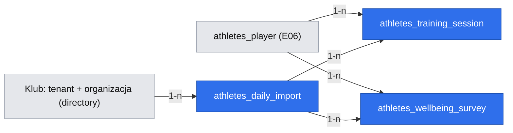

# E01 — Dane dzienne zawodników (wgrywanie arkuszy RPE i samopoczucia, Pulpit v1)

**Date**: 2026-10-31
**Status**: Ready for implementation — gotowość per faza (wszystkie decyzje rozstrzygnięte 2026-10-31):
- Faza 1 (wgrywanie pliku RPE): bramka fazy 1 E06; ta faza jest **właścicielem** wspólnego komponentu podglądu importu i parsera `.xlsx`/`.csv` (E02 faza 2 z nich korzysta); Q-001 (przegląd prawny) nie blokuje fazy 1.
- Faza 2 (wgrywanie ankiet samopoczucia): bramka fazy 1 tej specyfikacji.
- Faza 3 (Pulpit v1): bramka fazy 2.

Zakres klienta zatwierdzony (Q15, 2026-10-28).

> Źródła: `.ai/specs/2026-10-22-prd.md` (Stories 1–2, R12, R22, R23, R24, D266, D285, D302, D316, D330g, D333, D334, D335, D353, D378, D385, D397, N05, N17, N18), epik [#1](https://github.com/mikolajjenczyk/test_athletica/issues/1), historie [#8](https://github.com/mikolajjenczyk/test_athletica/issues/8) (E01-S01), [#9](https://github.com/mikolajjenczyk/test_athletica/issues/9) (E01-S02, tu w wersji v1), zadanie [#23](https://github.com/mikolajjenczyk/test_athletica/issues/23) (E01-S01-T01), prototyp `.ai/prototypes/discovery/Atletica-prototyp-lo-fi-rev-053/index.html` (tabela sesji RPE, „Wgraj plik RPE”, linia źródła danych, `WELL_Q`, `RISK_RULES`), raport panelu `.ai/specs/research/walkthroughs/2026-10-28-primary-flow-d271-session-001/report.md`. Q81 rozstrzygnięte 2026-10-28: arkusze leżą na komputerze trenera, trener wgrywa je sam. Zależy od `.ai/specs/2026-10-28-e06-cele-zalecenia-klub.md` (faza 1: klub = tenant z jedną organizacją, drużyna, zawodnicy, role). Dostarcza wspólny komponent podglądu importu i parser plików dla `.ai/specs/2026-10-28-e02-testy-i-wyniki.md` (faza 2 E02 zależy od fazy 1 tej specyfikacji).

## TLDR

Dziś zawodnicy wpisują RPE każdej sesji i poranną ankietę samopoczucia do arkuszy klubu, a trener łączy je ręcznie i nie wie od razu, kto nie wypełnił (`[DOCUMENT]`, relacja założyciela 21.10). Proponujemy (przyszłe zachowanie), w module `athletes`: trener wgrywa ze swojego komputera plik RPE i plik ankiet (`.xlsx` albo `.csv`); przed zapisem widzi odczytane wartości, braki, odrzucone wiersze z powodem i nazwiska z pliku, które sam łączy z zawodnikami drużyny; zapis nie dubluje i pokazuje korekty jako starą i nową wartość. Pulpit v1 otwiera dzień trenera kaflami obciążenia i samopoczucia oraz listą „Zwróć uwagę” liczoną tylko z danych. Luka to zawsze „Brak RPE” lub „Brak odpowiedzi”, nigdy zero.

## Problem Statement

- **Ręczne łączenie danych.** Trener łączy RPE, samopoczucie i testy w arkuszach (czas nieznany, A01). Najważniejsze dla niego: kto nie wypełnił, oraz przeciążenie, niedociążenie i spadek samopoczucia (PRD, Problem Statement — relacja założyciela).
- **Luka wygląda jak „w porządku”.** Pusta komórka nie odróżnia się od wypełnionej, a policzona jako zero fałszuje średnie (R12, guardrail PRD).
- **Codzienne wejście nie jest pewne.** Założenie A11 — dane dzienne ściągają trenera codziennie — sprawdza Pulpit (wskaźnik: Pulpit otwierany ≥ 4 dni w tygodniu).
- **Dane wrażliwe.** Zawodnicy są małoletni; samopoczucie widzi tylko trener (R23). Decyzja 2026-10-31: bez przeglądu prawnego po stronie produktu — zgody i bezpieczeństwo po stronie klubu (D332, D352); ochrona techniczna: szyfrowanie, tylko trener, brak tekstów.
- **Dowody.** `[DOCUMENT]` — relacja założyciela 21.10 (praktyka ogólna, nie obserwowany tydzień) i arkusze klienta z 20.10. A07 (czy arkusze są wypełniane codziennie) niesprawdzone. Panel syntetyczny 2026-10-28 (`[SYNTHETIC]`, hipotezy 7 i 14): trenerzy nie wiedzą, co zrobić z odrzuconym wierszem, a „Brak RPE” nie odróżnia nieobecności od niewypełnienia.

## Overview and Success Measures

- **Primary outcome:** trener ma dzienne dane drużyny w aplikacji jednym wgraniem na plik; w pilotażu klub wgrywa RPE jeszcze w 6. tygodniu (PRD, HEART: retencja).
- **Leading indicators:** Pulpit otwierany ≥ 4 dni w tygodniu (A11); odsetek wierszy odrzuconych na import; liczba ręcznych przypisań nazwisk na import (sygnał jakości plików).
- **Baseline:** brak (A01).
- **Market / product reference:** systemy AMS z dziennym wellnessem i sRPE (Smartabase, Kitman Labs, Teamworks — wiedza ogólna, bez weryfikacji źródeł). Przyjmujemy: sRPE = RPE × minuty, ankieta poranna w skali 1–5, sygnały względem własnej normy zawodnika. Odrzucamy: ACWR i modele ryzyka kontuzji (N05), integracje z urządzeniami (po MVP), ankiety w aplikacji dla zawodników (N01).

## Goals

- **REQ-001** — Trener wgrywa plik RPE (`.xlsx`/`.csv`) i przed zapisem widzi odczytane wartości, kto i w które dni nie ma RPE oraz odrzucone wiersze z numerem i powodem (R22, D266, D335).
- **REQ-002** — Nazwisko z pliku, którego nie da się jednoznacznie dopasować, trener w podsumowaniu importu łączy z zawodnikiem drużyny, który w tym imporcie nie jest jeszcze dopasowany; każdy zawodnik występuje w imporcie najwyżej raz; bez przypisania wiersze tego nazwiska są odrzucone (Q4).
- **REQ-003** — Wiersz RPE trafia do dokładnie jednego zawodnika i jednej sesji (zawodnik, data, numer sesji), nigdy dwa razy; zmieniona wartość pokazuje starą i nową i liczy się jako korekta (D266).
- **REQ-004** — RPE w skali 0–10, obciążenie = RPE × minuty (AU) liczone przez aplikację tylko z sesji z RPE; dwie sesje jednego dnia osobno; brak RPE to „Brak RPE”, nigdy 0 (D334, D302, R12).
- **REQ-005** — Trener wgrywa plik ankiet (`.xlsx`/`.csv`) z tym samym podglądem i przypisywaniem; z najwyżej trzech ankiet dnia liczy się oznaczona jako poranna albo wypełniona przed 12:00, a podgląd mówi która (D316, D330g).
- **REQ-006** — Sześć pytań ankiety w skalach arkusza: sen w godzinach, jakość snu, zmęczenie, ból mięśni, stres, nastrój (1–5, 5 = najlepiej / bez dolegliwości); brak ankiety to „Brak odpowiedzi”, nigdy 0 (D353, R12).
- **REQ-007** — Kolumny z wolnym tekstem (uwagi, notatki), ból i objawy poza skalą, „Kontakt?” są pomijane przy odczycie i nigdzie nie zapisywane (Q5, N18).
- **REQ-008** — Samopoczucie widzi tylko trener; odpowiedzi ankiety są szyfrowane (R23).
- **REQ-009** — Pulpit v1 dla trenera: tytuł z datą; linia świeżości danych z „Wgraj plik RPE” i „Wgraj plik ankiet”; kafle „Obciążenie sesji (RPE)” i „Samopoczucie”; „Zwróć uwagę” (D285, D370, D374, D389 — w części dziennej).
- **REQ-011** — Dostęp do danych dziennych: bez funkcji `athletes.daily.*` → 403; dyrektor i administrator bez roli trenera nie importują ani nie czytają danych dziennych; przypisanie zawodnika spoza klubu → 400 (D33).
- **REQ-012** — Pulpit zapisuje jedno wejście trenera na dzień (użytkownik, data), żeby zmierzyć A11 (≥ 4 dni w tygodniu) bez dodatkowych narzędzi analitycznych.
- **REQ-013** — Kontrakty dla SPEC 4, 5 i 7: zdarzenie `athletes.daily_import.committed` z ładunkiem `{ importId, kind, teamId, periodFrom, periodTo, saved, corrected, unchanged, rejected }`; serwis `athletesDailyService` z metodami `getSessions`, `getCountedSurveys`, `getSummary` (zakres z kontekstu); komponent `MiniChart` (7 dni, najnowsza wartość po prawej, D397); wspólny komponent podglądu importu z miejscem na panel dodatkowy (tu: przypisanie nazwisk).
- **REQ-014** — Historia importów (kto, kiedy, plik, okres, liczniki) i cofnięcie ostatniego importu komendą undo (przywraca poprzednie wartości, usuwa dodane wiersze).
- **REQ-010** — „Zwróć uwagę”: wiersz prostymi słowami z liczbami względem własnego poziomu zawodnika i mini-wykresem 7 dni; gdy ten sam sygnał ma więcej niż połowa zawodników z danymi, jedno ryzyko drużynowe zastępuje ich wiersze; nigdy prognoza kontuzji, diagnoza ani „niedotrenowany” (D333, D385, D397, R24, N05).

## Non-goals

- Automatyczny odczyt arkuszy z dysku (Q81 → trener wgrywa sam).
- Jakiekolwiek uwagi i notatki z plików (Q5 → brak), ból/objawy/„Kontakt?” (N18), dane medyczne, sen z urządzeń (N17).
- Zapamiętywanie przypisań nazwisk między importami (Q4 → przypisanie tylko w danym imporcie; możliwe rozszerzenie później).
- Odróżnianie nieobecności od niewypełnienia (panel `[SYNTHETIC]` hipoteza 14) — pliki tej informacji nie mają; pytanie zostaje do wywiadu z trenerem.
- Pozostałe sekcje Pulpitu (testy, „Test w trakcie”, cel, raporty, zalecenia, „Postęp drużyny”, linie AI) — SPEC 7; sygnał skoku (CMJ gotowości, Q80) i wzrostu (SPEC 4).
- Pulpit dla dyrektora i administratora (dyrektor nie widzi samopoczucia; administrator startuje na „Profil klubu”).

## Proposed Solution

W module `athletes` dwie ścieżki importu (RPE, ankiety) używają wspólnego komponentu podglądu z E02 fazy 2: wybór pliku → `preview` (parsowanie, dopasowanie po imieniu i nazwisku jak w E02, lista nieznanych nazwisk) → trener przypisuje nieznane nazwiska do niedopasowanych zawodników → `commit` z tym samym plikiem i mapą przypisań. Zapis jest idempotentny po kluczu naturalnym; zmiany wartości to korekty. Pulpit v1 to strona startowa trenera, czytająca dane przez serwis modułu, który liczy obciążenie, braki i sygnały „Zwróć uwagę” według reguł z prototypu.

### Design Decisions and Alternatives

| Decision | Rationale | Alternative considered | Why rejected / deferred |
|---|---|---|---|
| Dwa pliki, `.xlsx` i `.csv` (Q2/Q3) | Arkusze klubu są osobne; trener pobiera je w dowolnym formacie | Jeden plik z zakładkami; tylko CSV | Odrzucone przez użytkownika |
| Ręczne przypisanie nazwisk w podsumowaniu, bez aliasów (Q4) | Decyzja trenera, nie zgadywanie (R22); najmniejsza powierzchnia | Alias zapamiętany; tylko odrzucenie | Decyzja użytkownika 2026-10-31 |
| Podgląd bezstanowy (`preview` → `commit` z plikiem i mapą) | Pliki nie są przechowywane; brak tabeli tymczasowej | Zapis podglądu w bazie | Przechowywanie danych małoletnich bez potrzeby |
| Odpowiedzi ankiety szyfrowane, agregacje w pamięci | Dane zdrowotne małoletnich (RODO art. 9); drużyna ≤ 35 osób | Tylko kontrola dostępu (R23 minimum) | Mniejsza ochrona przy niewielkim koszcie |
| „Wgraj plik …” zamiast „Odśwież” w linii świeżości | Po Q81 nie ma czego odświeżać | „Odśwież” ponownie wczytujący ostatni plik | Mylące; wymaga akceptacji Toma (Q-002) |
| Pulpit v1 jako strona modułu, nie widżet `dashboards` | Stała kolejność sekcji (D285) i telefon 390 px | Widżety zainstalowanego `dashboards` | Konfigurowalny układ łamie D285 |
| Reguły „Zwróć uwagę” z prototypu rev-053 w kodzie jako stałe | Jedno źródło, testowalne | Konfigurowalne progi | Po MVP |

## Domain Vocabulary and Business Rules

| Term / invariant | Precise meaning or rule | Source of truth | Failure behavior |
|---|---|---|---|
| Plik RPE | Wiersz = jedna sesja zawodnika: imię i nazwisko, data, numer sesji (1, 2…), rodzaj, minuty, RPE 0–10; inne kolumny ignorowane | import | Brak wymaganej kolumny → plik odrzucony z nazwą kolumny |
| Sesja zawodnika | (zawodnik, data, numer sesji) unikalne; RPE null = „Brak RPE” | `athletes_training_session` | Ponowny import → aktualizacja lub bez zmian |
| Sesja drużyny | (data, numer sesji) występująca w pliku dla kogokolwiek z drużyny | wyliczane | Zawodnik bez wiersza w sesji drużyny → „Brak RPE” (chyba że `joined_at` późniejsze — „Dołączył później”) |
| Obciążenie | RPE × minuty (AU), tylko gdy oba są; liczone przy odczycie | wyliczane | Brak minut przy RPE → obciążenie puste, wiersz oznaczony w podglądzie |
| Plik ankiet | Wiersz = jedna ankieta: imię i nazwisko, znacznik czasu, oznaczenie poranna (opcjonalne), sen [h], jakość snu, zmęczenie, ból mięśni, stres, nastrój | import | Wartość spoza skali → wiersz odrzucony z powodem |
| Ankieta liczona | Z ankiet dnia: oznaczona jako poranna; jeśli żadna — najwcześniejsza przed 12:00; po 12:00 bez oznaczenia — nie liczy się (dzień = „Brak odpowiedzi”) | `athletes_wellbeing_survey.is_counted` | Podgląd pokazuje, która się liczy |
| Przypisanie nazwiska | Mapa (nazwisko z pliku → zawodnik) ważna tylko w jednym imporcie; jeden zawodnik najwyżej raz | parametr `commit` | Zawodnik już dopasowany → niedostępny na liście; konflikt → 400 |
| Korekta | Inna wartość dla istniejącego klucza; zapis `previous_*`, `corrected_at`; podgląd: stara → nowa | encje | — |
| Sygnał obciążenia | Suma 7 dni > średniej tygodniowej z 3 poprzednich pełnych tygodni bez braków o ponad 20% | wyliczane (prototyp `RISK_RULES`) | Za mało danych → brak sygnału, bez komunikatu „wszystko dobrze” |
| Sygnał snu | Sen < 6 h albo ≥ 1,5 h krócej niż średnia 14 dni | wyliczane | j.w. |
| Sygnał ankiety | Odpowiedź 1–2 albo ≥ 1,5 niżej niż średnia 14 dni (5 = najlepiej) | wyliczane | j.w. |
| Ryzyko drużynowe | Ten sam sygnał u > 50% zawodników z danymi → jeden wiersz drużyny zamiast wierszy zawodników (D333) | wyliczane | — |

## Users, Permissions, and Scope

| Actor | Allowed outcomes | Scope rule | Required feature IDs |
|---|---|---|---|
| Trener | Wgrywanie obu plików, przypisania, podgląd sesji RPE i ankiet, Pulpit v1 | własny klub (tenant i jego organizacja) | `athletes.daily.import`, `athletes.daily.view`, `athletes.wellbeing.view` |
| Dyrektor | Brak dostępu do samopoczucia; obciążenie drużyny tylko w raportach (SPEC 6) | — | brak w tej specyfikacji |
| Administrator klubu | Brak (chyba że ma też rolę trenera, E06 Q7) | — | — |

Zakres z kontekstu uwierzytelnionego żądania (E06: klub = tenant z jedną organizacją); dopasowanie nazwisk tylko wśród zawodników drużyny klubu; brak organizacji → 403. Odpowiedzi API z samopoczuciem wymagają `athletes.wellbeing.view`.

## Reuse and Ownership Map

| Capability | Reuse / extend / app-own | Existing module or new module | Integration seam | Why |
|---|---|---|---|---|
| Drużyna, zawodnicy, role | reuse | `athletes` (E06 faza 1) | id w module | Ten sam moduł |
| Podgląd importu | app-own, **właściciel: ta specyfikacja (faza 1)** | `athletes` | komponent podglądu (wiersze, braki, korekty, odrzucenia + miejsce na panel dodatkowy) i parser `.xlsx`/`.csv`; E02 faza 2 go używa | Jedno zachowanie R22, jeden właściciel, mniej zablokowana specyfikacja |
| Przypisanie nazwisk | app-own | `athletes` (ta specyfikacja) | osobny panel `NameAssignmentPanel` w miejscu na panel dodatkowy podglądu | Nie zmienia ogólnego komponentu |
| Dopasowanie nazwisk | reuse | `athletes` (E02, normalizacja) | funkcja modułu | Ta sama reguła co CSV testów |
| Sesje RPE, ankiety, importy | app-own | `athletes` | encje modułu | Domena aplikacji |
| Mini-wykres 7 dni | app-own, współdzielony | `athletes` | komponent `MiniChart` (D397) | Używany potem przez SPEC 4 i 7 |
| Dziennik zmian | reuse | `audit_logs` | komendy importu | — |

## Architecture and Data Flow

```text
Trener -> /backend/athletes/daily/import?kind=rpe|wellbeing
       -> POST /api/athletes/daily-imports/preview (plik, kind) -> { rows, missing, rejected, unknownNames }
       -> przypisanie nieznanych nazwisk (UI)
       -> POST /api/athletes/daily-imports/commit (plik, kind, assignments) -> komenda athletes.daily_import.commit
            -> athletes_training_session / athletes_wellbeing_survey (upsert po kluczu) + athletes_daily_import
            -> athletes.daily_import.committed (po commicie)
Trener -> /backend/athletes/pulpit -> GET /api/athletes/daily/summary -> serwis athletesDailyService (obciążenie, braki, sygnały)
```

- **Module boundaries:** wszystko w `athletes`; dane dzienne wskazują zawodników i muszą być w tym samym zakresie.
- **Extension points:** zdarzenie `athletes.daily_import.committed` dla SPEC 5 (obserwacje AI) i SPEC 7; serwis `athletesDailyService` w DI jako kontrakt odczytu dla SPEC 4, 5, 7.
- **Alternatives considered:** jedna encja „wpis dzienny” dla RPE i ankiet — odrzucona, bo różne klucze (sesja vs ankieta) i różna wrażliwość.
- **Compatibility:** tylko nowe encje, trasy, zdarzenia i funkcje. Strona Pulpitu należy do modułu `athletes` i tej specyfikacji; SPEC 7 dodaje do niej kolejne sekcje poprawką tej samej strony, nie tworzy nowej.

## User Journeys

### Journey J-001 — Wgranie pliku RPE

1. Trener na komputerze klika „Wgraj plik RPE” (Pulpit lub strona „Dane dzienne”), wybiera `.xlsx`/`.csv`.
2. Podgląd: okres pliku, odczytane sesje, „Brak RPE” per zawodnik i dzień, odrzucone wiersze (numer, powód), korekty (stara → nowa), lista nazwisk z pliku bez dopasowania.
3. Trener dla każdego nieznanego nazwiska wybiera zawodnika z listy niedopasowanych w tym imporcie albo zostawia „pomiń” (wiersze odrzucone); klika „Zapisz”.
4. Podsumowanie: zapisane, poprawione, bez zmian, odrzucone. Błąd: zły format lub brak kolumny → powód, nic nie zapisane; ponowny import tego samego pliku → „bez zmian”.

### Journey J-002 — Wgranie pliku ankiet

1–4. Jak J-001, z „Brak odpowiedzi” zamiast „Brak RPE” i informacją, która ankieta dnia się liczy. Wiersz z wartością spoza skali → odrzucony.

### Journey J-003 — Poranek na Pulpicie

1. Trener otwiera Pulpit: tytuł z datą, linia „RPE: dane z <dzień> · Ankiety: dziś 7:40” z przyciskami wgrania.
2. Kafle: obciążenie ostatniej sesji drużyny z liczbą „bez RPE”; samopoczucie „odpowiedziało N z M”.
3. „Zwróć uwagę”: wiersze zawodników albo jedno ryzyko drużynowe; dotknięcie wiersza otwiera panel szczegółu z liczbami i mini-wykresem (karta zawodnika w SPEC 4 zastąpi panel).
4. Brak danych: „Nie ma jeszcze danych — wgraj plik RPE lub ankiet”; za mało historii: brak sygnału, bez „wszystko dobrze”.

## UI and Interaction Contracts

Referencje: `.ai/guides/backend-ui.md`, wzorce `example` (`ui.page-shell`, `ui.datatable`), komponent podglądu z E02 fazy 2, prototyp rev-053 (linia źródła danych, kafle, „Zwróć uwagę”, tabela sesji RPE). Teksty w `src/modules/athletes/i18n/pl.json` (+ `en.json`).

| Surface / route | Purpose and primary actions | Data source / mutations | Closest installed reference | Canonical shell / components | Required states | Requirement IDs |
|---|---|---|---|---|---|---|
| `/backend/athletes/daily/import` (`?kind=rpe|wellbeing`) | Wybór pliku, podgląd, przypisanie nazwisk, „Zapisz”, podsumowanie | `POST /api/athletes/daily-imports/preview|commit` | podgląd importu E02 | `Page`, komponent podglądu, `DataTable`, kontrolki wyboru | loading, error (format), conflict, success, permission denied | REQ-001…REQ-007 |
| `/backend/athletes/daily` | „Dane dzienne”: sesje RPE i ankiety drużyny, filtr dat, historia importów | `GET /api/athletes/training-sessions`, `/wellbeing-surveys`, `/daily-imports` | `example/components/TodosTable.tsx` | `DataTable` | loading, empty, error | REQ-003, REQ-004, REQ-006, REQ-008 |
| `/backend/athletes/pulpit` | Pulpit v1 (strona startowa trenera) | `GET /api/athletes/daily/summary` | `example/backend/todos/page.tsx` (powłoka) | `Page`, `PageBody`, kafle, lista, panel boczny 400 px / ekran na telefonie, `MiniChart` | loading, empty, za mało danych, error, permission denied | REQ-009, REQ-010 |

### `/backend/athletes/daily/import` — podsumowanie importu z przypisaniem

```text
┌────────────────────────────────────────────────────────────┐
│ Wgraj plik RPE · rpe_tydzien_43.xlsx · 20–26.10   [Zapisz] │
├────────────────────────────────────────────────────────────┤
│ Odczytane: 142 sesje · Brak RPE: 9 · Korekty: 2 · Odrzucone: 3│
│ Nazwiska bez dopasowania:                                  │
│  „Kowalsky J.” (12 wierszy) → [ wybierz zawodnika ▾ | pomiń ]│
│ Braki: tabela zawodnik × dzień („Brak RPE”)                │
│ Odrzucone: wiersz 17 — RPE 12 poza skalą 0–10 …            │
└────────────────────────────────────────────────────────────┘
```

- **Behavior:** lista wyboru zawiera tylko zawodników drużyny jeszcze niedopasowanych w tym imporcie; po wyborze podgląd przelicza braki i korekty lokalnie, „Zapisz” wysyła plik i mapę; nieprzypisane nazwiska — wiersze odrzucone z powodem „nie przypisano zawodnika”.
- **Responsive and accessibility:** strona na komputer (≥ 1024 px); na telefonie komunikat „Wgraj plik na komputerze” (D344 analogicznie); fokus na pierwszym nieprzypisanym nazwisku; wynik ogłaszany przez region live.
- **Design-system and theming:** tokeny semantyczne; braki i odrzucenia tekstem, nie samym kolorem.

### `/backend/athletes/pulpit` — Pulpit v1

```text
┌──────────────────────────────────────┐
│ Pulpit · wtorek 31.10                │
│ RPE: dane z wczoraj · Ankiety: 7:40  │
│ [Wgraj plik RPE] [Wgraj plik ankiet] │
├──────────────────────────────────────┤
│ Obciążenie sesji (RPE) │ Samopoczucie│
│ śr. 420 AU · 2 bez RPE │ 18 z 24     │
│ ▁▃▅▇▅▃▆ (7 dni)        │ ▅▅▄▅▅▄▃     │
├──────────────────────────────────────┤
│ Zwróć uwagę                          │
│ J. Nowak — sen 5,2 h (zwykle 7,8 h) ›│
│ Drużyna — zmęczenie niżej u 14 z 24 ›│
└──────────────────────────────────────┘
```

- **Behavior:** kolejność stała (D285); wiersz otwiera panel szczegółu; ryzyko drużynowe zastępuje wiersze objętych zawodników; przyciski wgrania prowadzą do importu (na telefonie: informacja, że wgrywanie jest na komputerze).
- **Responsive:** 390 px — kafle w kolumnie, cele 44 px (NFR-007); ≥ 1024 px — kafle obok siebie, szczegół w panelu 400 px.
- **Copy:** wiersze bez słów diagnostycznych (R24); zawsze liczba i odniesienie do własnego poziomu; skala ankiety opisana w ⓘ.

### UI architecture

| Role | Navigation groups in order | Dashboard / injected widgets | Login-to-primary-task flow |
|---|---|---|---|
| Trener | Pulpit (start) → Drużyna → Dane dzienne, Testy, … | Pulpit v1 | logowanie → Pulpit → wiersz „Zwróć uwagę” (1 kliknięcie) |

| Surface / widget | Empty state guidance and action | Responsive behavior | Keyboard / focus behavior |
|---|---|---|---|
| Pulpit | „Nie ma jeszcze danych — wgraj plik RPE lub ankiet” | kolumna na telefonie | Tab po wierszach, Enter otwiera szczegół, Esc zamyka panel |
| Dane dzienne | „Brak sesji w wybranym okresie” | lista na telefonie | — |

## Data Models

Encje w `src/modules/athletes/data/entities.ts`, standardowe pola zakresu (`tenant_id`, `organization_id`), `updated_at`, `deleted_at`. Bez relacji ORM poza modułem.

### `athletes_training_session`

| Field | Type / nullability | Scope / index | Sensitive / encrypted | Lifecycle and validation |
|---|---|---|---|---|
| `player_id`, `session_date`, `session_no` | UUID, date, int | unikalne (org, player, session_date, session_no) | no | `session_date ≥ joined_at`, nie w przyszłości; `session_no` 1–3 |
| `kind` | text, nullable | — | no | z pliku (np. trening, mecz), ≤ 40 |
| `minutes`, `rpe` | int null, int null | — | no | minuty 1–300; RPE 0–10 (D334) |
| `previous_minutes`, `previous_rpe`, `corrected_at` | int null, int null, timestamp null | — | no | ostatnia korekta |
| `import_id` | UUID | — | no | ostatni import, który zmienił wiersz |

### `athletes_wellbeing_survey`

| Field | Type / nullability | Scope / index | Sensitive / encrypted | Lifecycle and validation |
|---|---|---|---|---|
| `player_id`, `answered_at` | UUID, timestamp | unikalne (org, player, answered_at) | no | nie w przyszłości |
| `survey_date`, `is_morning_marked`, `is_counted` | date, bool, bool | indeks (org, player, survey_date) | no | najwyżej jedna `is_counted` na (player, survey_date) |
| `sleep_hours` | decimal | — | **tak** | 0–16 |
| `sleep_quality`, `fatigue`, `soreness`, `stress`, `mood` | int | — | **tak** | 1–5 (5 = najlepiej / bez dolegliwości) |
| `previous_values`, `corrected_at` | json zaszyfrowany null, timestamp null | — | **tak** | ostatnia korekta |
| `import_id` | UUID | — | no | — |

### `athletes_pulpit_visit`

| Field | Type / nullability | Scope / index | Sensitive / encrypted | Lifecycle and validation |
|---|---|---|---|---|
| `user_id`, `visit_date` | UUID, date | unikalne (org, user, visit_date) | no | zapis przy pierwszym wejściu dnia; bez innych danych |

### `athletes_daily_import`

| Field | Type / nullability | Scope / index | Sensitive / encrypted | Lifecycle and validation |
|---|---|---|---|---|
| `kind` | enum `rpe`/`wellbeing` | indeks (org, kind, created_at) | no | — |
| `file_name`, `file_hash` | text, text | indeks (org, file_hash) | no | sam plik nie jest przechowywany |
| `period_from`, `period_to` | date, date | — | no | z pliku |
| `saved`, `corrected`, `unchanged`, `rejected`, `assigned_names` | int | — | no | liczniki |
| `rejected_rows` | json | — | no | `[{ line, reason }]` bez nazwisk |
| `imported_by_user_id` | UUID | — | no | z kontekstu |



`athletes_player` istnieje już w implementacji fazy 1 E06 (gałąź `feat/e06-phase-1-club`). Widok HTML w `.ai/data-model/` pominięty — Mermaid jest wiążący. Migracje: `yarn db:generate` po każdej fazie, przegląd, zastosowanie po zgodzie.

## API, Command, and Error Contracts

| Method / command | Path / ID | Auth and feature gate | Input | Success response / event | Errors and concurrency | Requirement IDs |
|---|---|---|---|---|---|---|
| `POST` | `/api/athletes/daily-imports/preview` | `athletes.daily.import` | multipart: plik (`.xlsx`/`.csv`, ≤ 2 MB, ≤ 5000 wierszy), `kind` | `{ period, rows, missing[], corrections[], rejected[{line, reason}], unknownNames[{ name, rowCount }], counted? }` — bez zapisu | 400 (format, kolumny), 413 | REQ-001, REQ-002, REQ-005, REQ-007 |
| `POST` | `/api/athletes/daily-imports/commit` | `athletes.daily.import` | multipart: plik, `kind`, `assignments: { [name]: playerId }` | `{ importId, saved, corrected, unchanged, rejected }`; `athletes.daily_import.committed` | 400 (zawodnik przypisany dwa razy, zawodnik spoza drużyny, zawodnik już dopasowany po nazwisku), 409 | REQ-002, REQ-003, REQ-005 |
| `GET` | `/api/athletes/training-sessions` | `athletes.daily.view` | `teamId`, `from`, `to`, `playerId?` | sesje z `load` wyliczonym i stanem „Brak RPE” | 403 | REQ-003, REQ-004 |
| `GET` | `/api/athletes/wellbeing-surveys` | `athletes.wellbeing.view` | j.w. | ankiety liczone + „Brak odpowiedzi” | 403 | REQ-006, REQ-008 |
| `GET` | `/api/athletes/daily-imports` | `athletes.daily.view` | `kind?` | historia importów | 403 | REQ-001 |
| `GET` | `/api/athletes/daily/summary` | `athletes.daily.view` + `athletes.wellbeing.view` | `teamId`, `date` | `{ freshness, loadTile, wellbeingTile, attention[] }`; zapisuje wejście dnia (idempotentnie) | 403 | REQ-009, REQ-010, REQ-012 |
| `POST` | `/api/athletes/daily-imports/undo` | `athletes.daily.import` | `{ importId }` (tylko ostatni import danego rodzaju) | `{ ok }`; `athletes.daily_import.undone` | 409 (nie ostatni) | REQ-014 |

Trasy odczytu przez `makeCrudRoute` (tylko GET) albo trasy własne z per-metodową `metadata` i `openApi`; zapis wyłącznie komendą `athletes.daily_import.commit` (atomowo: wszystkie wiersze i rekord importu w jednej transakcji; zdarzenie po commicie). Undo komendy przywraca `previous_*` i usuwa wiersze dodane przez import. Ponowny `commit` tego samego pliku z tą samą mapą daje „bez zmian”.

## Events, Jobs, Notifications, and Cross-Module Flows

| Trigger | Producer | Consumer | Side effect | Retry / idempotency / audit behavior |
|---|---|---|---|---|
| `athletes.daily_import.committed` | `athletes` | SPEC 5 (obserwacje AI), SPEC 7 (Pulpit), `audit_logs` | odświeżenie kontekstu | po commicie; ładunek: `importId`, `kind`, okres, liczniki — bez nazwisk i wartości ankiet |

Brak zadań w tle (import synchroniczny, ≤ 5000 wierszy).

## Security, Privacy, and Compliance

- **Authorization:** `athletes.daily.import`, `athletes.daily.view`, `athletes.wellbeing.view` tylko w szablonie roli trenera; dyrektor i administrator ich nie mają.
- **Tenant isolation:** zakres z kontekstu; dopasowanie i przypisania tylko do zawodników drużyny klubu; przypisanie zawodnika spoza klubu → 400; brak organizacji → 403.
- **Sensitive data:** odpowiedzi ankiety i `previous_values` w mapie szyfrowania; nazwiska zawodników odszyfrowywane w pamięci tylko na czas dopasowania; plik nie jest przechowywany; `rejected_rows` bez nazwisk i wartości; logi bez treści wierszy. Kolumny tekstowe i ból/objawy/„Kontakt?” nie są odczytywane (N18, Q5). Bez przeglądu prawnego po stronie produktu (decyzja 2026-10-31; zgody po stronie klubu, D332).
- **Abuse and failure modes:** limit rozmiaru i wierszy; zabezpieczenie parsera `.xlsx` przed formułami (czytamy tylko wartości), plikami zip-bomb (limit rozmiaru po rozpakowaniu) i wstrzyknięciem CSV przy ewentualnym eksporcie (wartości tekstowe nie są nigdzie eksportowane).

## Integration Coverage

| Test ID | Level | Setup / fixture | Actions | Assertions | Requirement IDs |
|---|---|---|---|---|---|
| TEST-001 | integration | drużyna, plik RPE `.xlsx` i `.csv` z lukami i złym wierszem | preview | braki per zawodnik i dzień, odrzucony wiersz z numerem i powodem, nic nie zapisane | REQ-001 |
| TEST-002 | integration | plik z nieznanym nazwiskiem | preview → commit z przypisaniem; commit z tym samym zawodnikiem dwa razy; bez przypisania | wiersze zapisane do wybranego; 400; wiersze odrzucone | REQ-002 |
| TEST-003 | integration | zapisany import | ten sam plik ponownie; plik ze zmienionym RPE | „bez zmian”; korekta stara → nowa, brak duplikatów | REQ-003 |
| TEST-004 | integration | dwie sesje dnia, sesja bez RPE, RPE bez minut | odczyt sesji | obciążenie RPE × minuty tylko z kompletów; „Brak RPE” zamiast 0 | REQ-004 |
| TEST-005 | integration | plik ankiet z trzema ankietami dnia, jedną po 12:00 bez oznaczenia | preview i commit | liczy się poranna / najwcześniejsza przed 12:00; dzień tylko z ankietą po 12:00 = „Brak odpowiedzi” | REQ-005, REQ-006 |
| TEST-006 | security | plik z kolumnami „Uwagi”, „Ból”, „Kontakt?” | commit | żadnej z tych wartości w bazie ani w odpowiedziach | REQ-007 |
| TEST-007 | security | kluby A i B; dyrektor; trener A | odczyt ankiet jako dyrektor i z klubu B | 403; brak danych B; kolumny ankiet zaszyfrowane w bazie | REQ-008 |
| TEST-008 | integration | 4 tygodnie danych z jednym zawodnikiem ponad +20% i 14 z 24 ze spadkiem zmęczenia | `GET /daily/summary` | wiersz zawodnika z liczbami; jedno ryzyko drużynowe zamiast 14 wierszy; brak słów diagnostycznych | REQ-010 |
| TEST-009 | UI | Pulpit v1 | pusty, za mało danych, pełny; 390 px i ≥ 1024 px; klawiatura; jasny/ciemny | stany i kolejność zgodne z D285 | REQ-009 |
| TEST-011 | security | kluby A i B; dyrektor; użytkownik bez funkcji | import i odczyt RPE jako dyrektor i bez funkcji; przypisanie zawodnika B w imporcie A | 403; 403; 400 | REQ-011 |
| TEST-012 | integration | trener | dwa wejścia na Pulpit tego samego dnia, jedno następnego | 2 wiersze `athletes_pulpit_visit` | REQ-012 |
| TEST-013 | integration | import RPE | commit; wywołanie `athletesDailyService.getSummary`; undo ostatniego importu; undo starszego | zdarzenie z zamrożonym ładunkiem bez nazwisk; kształt odpowiedzi serwisu; dane przywrócone; 409 | REQ-013, REQ-014 |
| TEST-010 | UI | strony importu i „Dane dzienne” | loading/error/conflict, telefon (komunikat o komputerze), region live | obserwowalne stany | REQ-001…REQ-006 |

Ścieżki: `.ai/qa/tests/athletes/daily-*.spec.ts`; testy jednostkowe reguł sygnałów w `src/modules/athletes/lib/__tests__/`.

## Implementation Phases

### Phase 1 — Wgrywanie pliku RPE (E01-S01 #8, E01-S01-T01 #23 — część RPE)

- **Depends on:** bramka fazy 1 E06
- **Outcome:** trener wgrywa plik RPE, przypisuje nieznane nazwiska i widzi sesje z obciążeniem i brakami.
- **Why this order / value delivered:** RPE to najczęstsze dane; daje obciążenie dla Pulpitu i AI.
- **Deliverables:** wspólny komponent podglądu importu i parser `.xlsx`/`.csv` (właściciel); `NameAssignmentPanel`; `athletes_training_session`, `athletes_daily_import`; parser kolumn RPE; komenda `athletes.daily_import.commit` (RPE) z undo i trasa `undo`; trasy `preview`, `commit`, `training-sessions`, `daily-imports`; zdarzenie `athletes.daily_import.committed`; strony importu i „Dane dzienne” (zakładka RPE, historia importów); funkcje ACL `athletes.daily.*` w szablonie trenera.
- **Independent slices / estimated commits:** parser + komenda, trasy, UI; ~4 commity.
- **Requirements closed:** REQ-001…REQ-004, REQ-007 (RPE), REQ-011, REQ-013 (zdarzenie, komponent podglądu), REQ-014
- **Tests:** TEST-001…TEST-004, TEST-006 (RPE), TEST-010, TEST-011, TEST-013 (import i undo)
- **Validation:** `yarn generate`, `yarn db:generate` (przegląd), `yarn typecheck`, `yarn lint`, `yarn ds:check`, `yarn test`, `yarn test:integration:ephemeral`
- **Exit gate:** J-001 przechodzi na pliku `.xlsx` i `.csv`; ponowny import nie dubluje; jeden prawdziwy tydzień (A07) wczytany, jeśli klient go dostarczy.

### Phase 2 — Wgrywanie ankiet samopoczucia (E01-S01 #8, część ankiet)

- **Depends on:** Phase 1 exit gate
- **Outcome:** trener wgrywa ankiety; widzi liczone ankiety i „Brak odpowiedzi”; samopoczucie zaszyfrowane i tylko dla trenera.
- **Why this order / value delivered:** ten sam przepływ co faza 1; dane bardziej wrażliwe, więc po sprawdzeniu ścieżki na RPE.
- **Deliverables:** `athletes_wellbeing_survey` z mapą szyfrowania; parser ankiet z pomijaniem kolumn N18; wybór ankiety liczonej; trasa `wellbeing-surveys`; zakładka ankiet w „Dane dzienne”; funkcja `athletes.wellbeing.view`.
- **Independent slices / estimated commits:** ~3 commity.
- **Requirements closed:** REQ-005, REQ-006, REQ-007 (ankiety), REQ-008
- **Tests:** TEST-005, TEST-006 (ankiety), TEST-007, TEST-010
- **Validation:** jak w fazie 1
- **Exit gate:** J-002 przechodzi; TEST-007 potwierdza szyfrowanie i brak dostępu dyrektora.

### Phase 3 — Pulpit v1 (E01-S02 #9, część dzienna)

- **Depends on:** Phase 2 exit gate (Q-002 nieblokujące)
- **Outcome:** trener zaczyna dzień od Pulpitu z kaflami i „Zwróć uwagę”.
- **Why this order / value delivered:** pozwala zmierzyć A11 przed SPEC 7.
- **Deliverables:** serwis `athletesDailyService` (obciążenie, braki, sygnały, ryzyko drużynowe) w DI; trasa `daily/summary` z zapisem wejścia dnia; `athletes_pulpit_visit`; komponent `MiniChart`; strona Pulpit v1 ustawiona jako strona startowa roli trenera (najwyższy priorytet w nawigacji); panel szczegółu wiersza.
- **Independent slices / estimated commits:** serwis i reguły z testami jednostkowymi, UI; ~4 commity.
- **Requirements closed:** REQ-009, REQ-010, REQ-012, REQ-013 (serwis, `MiniChart`)
- **Tests:** TEST-008, TEST-009, TEST-012, TEST-013 (serwis)
- **Validation:** jak w fazie 1
- **Exit gate:** J-003 przechodzi przy 390 px i ≥ 1024 px, jasny/ciemny; reguły pokryte testami jednostkowymi; brak słów z R24.

## Requirement Traceability

| Requirement | Journey / surface | Data/API/event contracts | Phase | Tests | Acceptance criterion |
|---|---|---|---|---|---|
| REQ-001 | J-001, import | `preview` | 1 | TEST-001 | AC-001 |
| REQ-002 | J-001, import | `commit.assignments` | 1 | TEST-002 | AC-002 |
| REQ-003 | J-001 | `athletes_training_session` klucz, `previous_*` | 1 | TEST-003 | AC-003 |
| REQ-004 | „Dane dzienne” | `load` wyliczane | 1 | TEST-004 | AC-004 |
| REQ-005 | J-002 | `is_counted` | 2 | TEST-005 | AC-005 |
| REQ-006 | J-002, „Dane dzienne” | `athletes_wellbeing_survey` | 2 | TEST-005 | AC-006 |
| REQ-007 | J-001, J-002 | parser pomija kolumny | 1–2 | TEST-006 | AC-007 |
| REQ-008 | „Dane dzienne”, Pulpit | mapa szyfrowania, `athletes.wellbeing.view` | 2 | TEST-007 | AC-008 |
| REQ-009 | J-003, Pulpit | `daily/summary` | 3 | TEST-009 | AC-009 |
| REQ-010 | J-003 | `athletesDailyService` | 3 | TEST-008 | AC-010 |
| REQ-011 | import, „Dane dzienne” | funkcje `athletes.daily.*`, walidacja przypisania | 1 | TEST-011 | AC-011 |
| REQ-012 | Pulpit | `athletes_pulpit_visit` | 3 | TEST-012 | AC-012 |
| REQ-013 | kontrakty | zdarzenie, serwis, `MiniChart`, komponent podglądu | 1, 3 | TEST-013 | AC-013 |
| REQ-014 | „Dane dzienne” | `daily-imports`, `undo` | 1 | TEST-013 | AC-014 |

Powierzchnie rozszerzeń (wszystkie `emitted-example`):

| Surface | Requirement | Reference capability → exact source | Phase | Integration test | Mechanism |
|---|---|---|---|---|---|
| Funkcje ACL `athletes.daily.*`, `athletes.wellbeing.view` | REQ-008 | `module.acl-features` → `src/modules/example/acl.ts` | 1–2 | TEST-007 | emitted-example |
| Szablon roli trenera (nowe funkcje) | REQ-008 | `module.setup-role-features` → `src/modules/example/setup.ts` | 1–2 | TEST-007 | emitted-example |
| Encje danych dziennych | REQ-003, REQ-006 | `data.entities` → `src/modules/example/data/entities.ts` | 1–2 | TEST-003, TEST-005 | emitted-example |
| Walidatory wierszy | REQ-001, REQ-005 | `data.validators` → `src/modules/example/data/validators.ts` | 1–2 | TEST-001, TEST-005 | emitted-example |
| Mapa szyfrowania ankiet | REQ-008 | `data.encryption-map` → `src/modules/example/encryption.ts` | 2 | TEST-007 | emitted-example |
| Komenda importu z undo | REQ-003 | `commands.undo-redo` → `src/modules/example/commands/todos.ts` | 1–2 | TEST-003 | emitted-example |
| Trasy własne (preview, commit, summary) | REQ-001, REQ-002, REQ-009 | `api.custom-route` → `src/modules/example/api/organizations/route.ts` | 1–3 | TEST-001, TEST-002, TEST-008 | emitted-example |
| Trasy odczytu | REQ-004, REQ-006 | `api.crud-factory` → `src/modules/example/api/customer-priorities/route.ts` | 1–2 | TEST-004, TEST-005 | emitted-example |
| OpenAPI | wszystkie | `api.openapi` → `src/modules/example/api/openapi.ts` | 1–3 | TEST-001 | emitted-example |
| Zdarzenie `athletes.daily_import.committed` | REQ-003 | `events.typed-definitions` → `src/modules/example/events.ts` | 1 | TEST-003 | emitted-example |
| Serwis w DI | REQ-010 | `module.di-registration` → `src/modules/example/di.ts` | 3 | TEST-008 | emitted-example |
| Strony | REQ-001, REQ-009 | `ui.page-shell` → `src/modules/example/backend/todos/page.tsx`; `ui.datatable` → `src/modules/example/components/TodosTable.tsx` | 1–3 | TEST-009, TEST-010 | emitted-example |
| Katalogi i18n | wszystkie | `module.i18n-catalogs` → `src/modules/example/i18n/pl.json` | 1–3 | TEST-010 | emitted-example |

## Rollout, Migration, and Rollback

- Migracje po każdej fazie (`yarn db:generate`), przegląd SQL i snapshotu, zastosowanie po zgodzie; tylko nowe tabele.
- Import cofany komendą undo (przywraca `previous_*`, usuwa dodane wiersze); całe dane dzienne klubu znikają z miękkim usunięciem klubu (E06).
- Pulpit v1 ustawiany jako strona startowa trenera; SPEC 7 rozszerza tę samą stronę.
- Brak flag funkcji.

## Risks and Tradeoffs

| Risk / tradeoff | Impact | Mitigation / detection | Residual risk |
|---|---|---|---|
| Układ kolumn arkuszy klienta inny niż zakładany (D301) | Odrzucenie całego pliku | Nagłówki z prototypu + synonimy (decyzja 2026-10-31); komunikat z nazwą brakującej kolumny; prawdziwy tydzień (A07) do odbioru fazy | Średnie do czasu próbki |
| Częste literówki w nazwiskach (zawodnicy wpisują sami) | Wiele ręcznych przypisań przy każdym imporcie | Licznik przypisań jako wskaźnik; aliasy jako możliwe rozszerzenie | Akceptowane (decyzja Q4) |
| Szyfrowanie ankiet — agregacje w pamięci | Koszt przy długiej historii | Okna 7/14/21 dni, drużyna ≤ 35 | Niski |
| Dane zdrowotne małoletnich (RODO art. 9) bez przeglądu prawnego | Ryzyko prawne po stronie klubu i Apzumi | Szyfrowanie, tylko trener, brak tekstów; decyzja użytkownika 2026-10-31 (zgody po stronie klubu, D332, D352) | Średnie — świadomie przyjęte |
| Progi sygnałów z prototypu (przyjęte 2026-10-31) | Fałszywe alarmy lub ich brak | Stałe w jednym miejscu, testy jednostkowe; przegląd z klientem po pierwszych tygodniach pilotażu | Średnie |
| „Brak RPE” nie odróżnia nieobecności | Trener widzi braki u nieobecnych | Wiersz „Brak RPE” bez oceny; pytanie do wywiadu (hipoteza 14) | Akceptowane |
| Komponent podglądu współdzielony z E02 | Zmiana w E01 może zepsuć import CSV testów | Ta specyfikacja właścicielem; panel dodatkowy zamiast modyfikacji; testy E02 fazy 2 na tym samym komponencie | Niski |

## Acceptance Criteria

- [ ] **AC-001** — Podgląd pliku RPE (`.xlsx` i `.csv`) pokazuje okres, odczytane sesje, „Brak RPE” per zawodnik i dzień oraz odrzucone wiersze z numerem i powodem, niczego nie zapisując.
- [ ] **AC-002** — Nieznane nazwisko można przypisać tylko do zawodnika drużyny niedopasowanego w tym imporcie; zawodnik nie może być przypisany dwa razy; nieprzypisane wiersze są odrzucone.
- [ ] **AC-003** — Ponowny import tego samego pliku nie zmienia danych; zmieniona wartość jest korektą ze starą i nową wartością; brak duplikatów (zawodnik, data, numer sesji).
- [ ] **AC-004** — Obciążenie = RPE × minuty tylko z kompletnych sesji; dwie sesje dnia osobno; brak RPE nigdy jako 0.
- [ ] **AC-005** — Z kilku ankiet dnia liczy się poranna albo najwcześniejsza przed 12:00, a podgląd to pokazuje.
- [ ] **AC-006** — Sześć pytań ankiety zapisanych w skalach arkusza; brak ankiety to „Brak odpowiedzi”.
- [ ] **AC-007** — Żadna kolumna z wolnym tekstem, bólem, objawami ani „Kontakt?” nie trafia do bazy ani odpowiedzi.
- [ ] **AC-008** — Odpowiedzi ankiet są zaszyfrowane w bazie; dyrektor i administrator bez roli trenera dostają 403.
- [ ] **AC-009** — Pulpit v1 pokazuje w kolejności: tytuł z datą, linię świeżości z przyciskami wgrania, kafle, „Zwróć uwagę”; działa przy 390 px i ≥ 1024 px.
- [ ] **AC-011** — Bez funkcji `athletes.daily.*` import i odczyt dają 403; przypisanie zawodnika z innego klubu daje 400.
- [ ] **AC-012** — Wejścia na Pulpit są liczone raz na trenera na dzień.
- [ ] **AC-013** — Zdarzenie importu ma zamrożony ładunek bez nazwisk; serwis i komponenty z REQ-013 mają testy kontraktu.
- [ ] **AC-014** — Historia pokazuje importy; cofnięcie ostatniego importu przywraca poprzednie wartości, starszego — 409.
- [ ] **AC-010** — „Zwróć uwagę” pokazuje sygnały z liczbami względem własnego poziomu; > 50% zawodników z tym samym sygnałem daje jedno ryzyko drużynowe; brak słów z R24.
- [ ] Every listed backend surface matches its recorded Open Mercato reference and uses the canonical shell/components, shared API helpers, semantic tokens, and complete loading, empty, error, conflict, keyboard, accessibility, responsive, light-mode, and dark-mode states.
- [ ] Every affected API and UI path has self-contained integration coverage and the configured validation gate passes.

## Final Compliance Report

| Check | Status | Evidence / resolution |
|---|---|---|
| Applicable `AGENTS.md` files and routed guides/skills reviewed | pass | `AGENTS.md`, `spec-delivery.md`, `SPEC-000-template.md`, `surface-inventory.json`, specyfikacje E06 i E02, encje `athletes` z implementacji fazy 1 E06 |
| Data models, APIs, events, UI, and tests are internally consistent | pass | Requirement Traceability |
| Every workflow completes end to end without a catch-all integration phase | pass | J-001…J-003, fazy 1–3 |
| Platform-native reuse and extension points were chosen before custom code | pass | Reuse map; Pulpit jako strona uzasadniony |
| UI contracts identify references, canonical components, and theme/state coverage | pass | UI and Interaction Contracts |
| Every phase has dependencies, bounded slices, tests, value, and an observable exit gate | pass | Implementation Phases |

Verdict: `Ready for implementation` po bramce fazy 1 E06 (faza 1); fazy 2–3 po bramkach poprzednich faz.

## Decisions in play

| Id | Decision | Effect in this spec | Owner |
|---|---|---|---|
| Q81 | Arkusze na komputerze trenera, trener wgrywa | Brak automatycznego odczytu; D335 jedyną ścieżką | rozstrzygnięte 2026-10-28 |
| D285, D370, D374, D389 | Kolejność Pulpitu | Pulpit v1 realizuje część dzienną; reszta w SPEC 7 | Tom |
| „Odśwież” w linii świeżości (Story 2) | Ręczne ponowne wczytanie arkusza | **Zastąpione:** „Wgraj plik RPE” / „Wgraj plik ankiet” z datą ostatnich danych (decyzja 2026-10-31) | użytkownik |
| R23 | Samopoczucie tylko dla trenera | Utrzymane + szyfrowanie odpowiedzi | Tom |
| N18 | Bez bólu, objawów, „Kontakt?”, notatek z ankiet | Utrzymane; dodatkowo brak „Uwag” z RPE (Q5) | — |

## Open Questions

| ID | Question | Owner | Blocking? | Resolution / decision date |
|---|---|---|---|---|
| ~~Q-001~~ | Przegląd prawny danych samopoczucia | użytkownik | — | 2026-10-31: bez przeglądu; zgody i bezpieczeństwo po stronie klubu (D332, D352) |
| ~~Q-002~~ | Zastąpienie „Odśwież” | użytkownik | — | 2026-10-31: przyciski „Wgraj plik RPE” / „Wgraj plik ankiet” |
| ~~Q-003~~ | Skala RPE (D334) | użytkownik | — | 2026-10-31: 0–10 |
| ~~Q-004~~ | Układ kolumn (D301), prawdziwy tydzień (A07) | użytkownik | — | 2026-10-31: nagłówki z prototypu + synonimy; prawdziwy tydzień tylko do odbioru fazy |
| ~~Q-005~~ | Progi „Zwróć uwagę” | użytkownik | — | 2026-10-31: jak w prototypie; przegląd z klientem po pierwszych tygodniach pilotażu |
| ~~Q1~~ | Zakres | użytkownik | — | 2026-10-31: wgrywanie + Pulpit v1 |
| ~~Q2/Q3~~ | Pliki | użytkownik | — | 2026-10-31: dwa pliki, `.xlsx` i `.csv` |
| ~~Q4~~ | Nieznane nazwiska | użytkownik | — | 2026-10-31: przypisanie w podsumowaniu importu do niedopasowanego zawodnika, każdy zawodnik raz w imporcie; bez zapamiętywania |
| ~~Q5~~ | Kolumny tekstowe | użytkownik | — | 2026-10-31: żadnych uwag |

## Changelog

| Date | Change |
|---|---|
| 2026-10-31 | Szkielet z Open Questions Q1–Q5 |
| 2026-10-31 | Odpowiedzi Q1–Q5; pełna specyfikacja, trzy fazy |
| 2026-10-31 | Recenzja spójności zakresu: E01 faza 1 właścicielem podglądu importu (zamiast E02 fazy 2), przypisanie nazwisk jako osobny panel; REQ-011 (dostęp, TEST-011) w fazie 1; REQ-012 pomiar A11; REQ-013 kontrakty dla SPEC 4/5/7; REQ-014 historia i undo; Q-002 nieblokujące; strona Pulpitu należy do `athletes`, SPEC 7 ją rozszerza |
| 2026-10-31 | Rozstrzygnięte Q-001…Q-005: bez przeglądu prawnego (zgody po stronie klubu); przyciski wgrania zamiast „Odśwież”; RPE 0–10; nagłówki z prototypu + synonimy; progi z prototypu. Status: Ready for implementation po bramce fazy 1 E06 |
